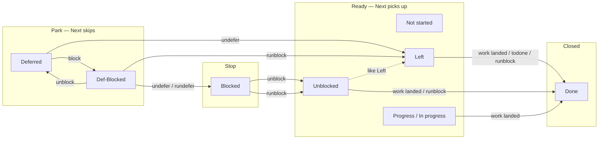

# Phasify — user reference

Print this file as the response when the user runs `/phasify help`,
`/phasify --help`, or `/phasify /?`. Do not execute, defer, undefer,
rundefer, todo, todone, explain, dummy, coach, instruct, ask, block, unblock, runblock, howto, remove,
delete, or show.
`/phasify tldr` prints the short page (`references/TLDR.md`), not
this file.

If the remaining body after flag strip is exactly `pass` or
`pass help` (case-insensitive), print only the **Pass (`Npass`)**
section below and stop. There is no `/pass` skill.

Empty `/phasify` is **Next**, not this page.

A normal `/phasify` run does not read this file.

---

## What it does

Execute one or more phases of an existing **plannify** plan. Not a new
planning pass and not a full-plan `/runnify`. Implement only the selected
phase(s). Aliases: `/phaseify`, `/phify`.

Need a new plan from current statuses? Use **`/plannify fromhere`**
(plannify skill) — not a phasify mode.

`from=` / `from:` splices local files into the prompt (see `docs/from_contract.md`).

A typed-line `docify` / `docpathify` writes this verb's deliverable
(see `the docify skill's references/docify_contract.md`). Guide and coach cite `docs/docify_contract.md`. Help, exact tldr, and pass do not write.

Window name is `PHASE:P<n>/<total>:<PREFIX>: <summary>` (see
`docs/window_title.md`). Empty `/phasify` is Next, so it retitles.
Help and pass do not. Exact `tldr` does not. Ask, a tldr question, and a dummy question do not retitle. Dummy, a tldr phase tell, and guide use the phase they are about. Howto, coach, and instruct use the parent phase.

---

## Concepts

Plain-language meanings. Token tables and parse rules follow below.
Agents: this is the user-facing page — keep these definitions in view.

### Status words

Cite phasify `SKILL.md` (Status words / Execute / Undefer / Block /
Unblock / Runblock / Todone). Do **not** invent statuses.

| Status | Where it appears | Meaning |
|--------|------------------|---------|
| `Not started` | Markdown plan tables (plannify / promptify) | Fresh / not-yet-executed. Not a 12-wide recap spelling — use `Left` there. |
| `Left` | Aligned recap + work phases | Still to do. Next picks it up. Remaining unstarted work after a partial run. |
| `Unblocked` | Work phases | Blocker cleared. Ready **like** `Left`, not complete. |
| `Progress` | Aligned 12-wide table | Started, not finished. **Never** write `In progress` here (too long). |
| `In progress` | Markdown plan tables only | Same meaning as `Progress`. Spelling split: markdown vs 12-wide recap. |
| `Deferred` | Work phases | Parked on purpose (“not now”). Next / bare todo skip it. |
| `Blocked` | Work phases | Hard stop. Execute-next cannot proceed through it. |
| `Def-Blocked` | Work phases | Table spelling of **Deferred-Blocked** (11 chars; fits 12-wide). Parked **and** blocked. |
| `Done` | Work phases | Finished. Only if the work **landed**, closed by **todone**, or closed by **runblock** when nothing is automatable. |
| `Planned` | **Task** row only | Task-row / not-started planning state. Not a work-phase Status. |
| `Understood` | **Flags** row only | Flags captured. Not a work-phase Status. |

**Not statuses:** `todo`, `todone`, `explain`, `dummy`, `guide`, `coach`, `instruct`, `ask`, and `howto` are **commands**. Todo prints a
list and does not change Status. Todone prints the list, then sets
Status `Done` (no execute, no ack wait). Explain, dummy, a tldr phase tell, guide, coach, instruct, and ask do not change Status. Howto prints steps past a
block and does not change Status. Guide is a second word, not runblock. Coach is its own mode. Instruct is its own mode.

### How statuses tie together

Park vs stop vs ready vs closed. Transitions below are the ones
already in phasify `SKILL.md` — do not add others.



- `Deferred` → `Left` (undefer; clear defer Reason)
- `Deferred` → `Def-Blocked` (block)
- `Def-Blocked` → `Blocked` (undefer / rundefer; keep blocker Reason)
- `Def-Blocked` → `Deferred` (unblock; stay parked)
- `Def-Blocked` → `Left` (runblock; clear **both** block and defer)
- `Blocked` → `Unblocked` (unblock)
- `Blocked` → `Unblocked` then run-or-mark-Done (runblock)
- `Unblocked` is treated like `Left` (ready, not complete)
- `Done` only if work landed, **todone** asserted it, or **runblock**
  marked it when nothing is automatable
- **Next** skips `Done`, `Deferred`, and `Def-Blocked`

Task `Planned` and Flags `Understood` sit outside this work-phase
graph.

### Not yet executed

`Not started` (markdown tables) and `Left` (aligned recap) both mean
the phase has not finished. Fresh plannify rows often say `Not
started`. After a run starts, remaining unstarted work is **`Left`**.
Next treats both as eligible (not `Done`, not `Deferred`, not
`Def-Blocked`). `Unblocked` is the same “ready” bucket after a
blocker clears.

### Done

Status **`Done`** means the phase finished. Mark `Done` only if the
work **landed**. Exception: **todone** (user asserts the work; briefing
then `Done`; no execute). Exception: **runblock** marks `Done` when
the blocked phase has no remaining automation (short note; no Todo
briefing). Named todo / named block of a
`Done` phase is an **Error:**. Named explain, dummy, and a tldr phase tell may target `Done` and report what landed. Done content is what landed. A thin record says so and quotes the phase description. Do not invent work. Next and bare todo skip `Done`. Count selectors on explain, dummy, and tldr skip `Done`.

### Deferred phase

A phase with Status **`Deferred`** (or **`Def-Blocked`**) is parked on
purpose. Next, execute (`/phasify` / `next` / Next-N / done / `-N`),
bare todo, bare todone, and bare rundefer-eligibility **skip** it until
you **undefer** or **rundefer**. Bare **explain** / `explain N`, bare **dummy** / `dummy N`, and a tldr phase tell do
**not** skip Deferred / Def-Blocked — they tell the park. They do not change Status.

This is **not** the same as **Blocked**. Blocked is a hard stop:
execute-next cannot proceed through it. Deferred means “not now” —
later, out of order, or waiting on something that is **not** a hard
blocker.

**Why you’d defer:** run other phases first; come back out of order;
wait without treating the wait as a hard blocker.

**Undefer** (status only — does **not** execute):

- `Deferred` → `Left` (clear the defer Reason)
- `Def-Blocked` → `Blocked` (keep the blocker Reason)

**Rundefer** undefer then immediately executes the just-undeferred
runnable phases (see **Rundefer**). A `Def-Blocked` target becomes
`Blocked` and execute **stops** on it — it does not become runnable.

### Todo

`/phasify todo` prints a **detailed actionable list** for a phase. It
does **not** execute the phase and does **not** change Status.

| Command | List? | Status? | Execute? |
|---------|-------|---------|----------|
| `/phasify todo` | Yes | No change | No |
| `/phasify explain` | No (write-up + glossary + TL/DR) | No change | No |
| `/phasify todone` | Same list | Then `Done` (no ack wait) | No |
| `/phasify` / `next` / named `pN` | No | After work | **Yes** — implement the phase |

Todone means you already did (or are asserting) the work. Execute
(`/phasify` / next) is what actually implements a phase.

### Explain

`/phasify explain` prints a **full explanation** of a phase: what is
in it, why it exists, what its Status means (defer / todo / blocked
glossary), and a mandatory **TL/DR**. It does **not** execute the
phase, does **not** change Status, and does **not** rewrite or
reprint the phased plan. The **TL/DR** is the explanation only.

Todo is a numbered checklist (manual vs agent). Explain is a
write-up + status glossary + TL/DR — not a task list. Bare explain
targets the next not-`Done` phase **including** Deferred /
Def-Blocked (unlike bare todo). `explain N` / `Nexplain` /
`explainN` = next N not-Done, not named PN. Count selectors skip
`Done`. Named is only the `P`/`p` family and may be `Done` (what
landed). Pending stays this full write-up. Optional second word
`guide` (`explain guide`, `3explain guide`).

**Blocked**, **Def-Blocked**, and partially blocked (`Progress`
with a recorded blocker, same as howto) add detailed steps from
the record. Other statuses get no unblock list. **Done content**
is what landed. A thin record says so and quotes the phase
description. Do not invent work.

### Dummy

`/phasify dummy` is the non-technical tell of the next not-Done
phase: the intent, then a simple description. No commands, paths,
or APIs. It does **not** execute, does **not** change Status, and
does **not** rewrite or reprint the plan. `dummy N` / `Ndummy` /
`dummyN` = next N not-Done, **not** named PN. Named is only
`dummy pN` and may be `Done`. `dummy 0` is **Error:** (use
`dummy p0`). Optional second word `guide` (`dummy guide`).
Bare `dummy`, `dummy N`, `dummy pN`, and `dummy guide` stay the
phase tell. A remainder that is not a selector and not `guide`
is a plain-language question. No commands, paths, or APIs. Does
not retitle.

**Blocked**, **Def-Blocked**, and partially blocked (`Progress`
with a recorded blocker, same as howto): spelled-out task names,
not enough to perform them. Other statuses get no unblock list.
**Done content** is what landed. A thin record says so and quotes
the phase description. Do not invent work.

### Tldr of a phase

Exact `/phasify tldr` with no other token prints
`references/TLDR.md` and stops. That is never a phase id.
`tldr help` is not help.

A phase tell needs a selector: `tldr 1`, `tldr N`, `Ntldr`,
`tldrN`, `tldr pN`, `pN tldr`. `tldr N` = next N not-Done, not
named PN. Named `pN` may be `Done`. `tldr 0` is **Error:** (use
`tldr p0`). The tell is the explanation only (no process, no
followup). Optional second word `guide`. Any other remainder is
a short direct answer: a few sentences, no headings, no process
narration, no follow-up. Do not execute. Do not change Status.
Do not rewrite or reprint the plan. Do not retitle. Exact `tldr`
and a selector still win.

**Blocked**, **Def-Blocked**, and partially blocked (`Progress`
with a recorded blocker, same as howto): a numbered list a
capable person could carry out. Other statuses get no unblock
list. **Done content** is what landed. A thin record says so and
quotes the phase description. Do not invent work.

### Guide

`guide` is **only** the second word on explain, tldr, or dummy
(`explain guide`, `tldr guide p3`, `dummy guide`, `3explain guide`).
It is not a mode of its own and it is not runblock. Match `coach`
before `guide`. A leading `guide` is **Error:**. `coach guide` is
**Error:**.

Every target must be blocked or partially blocked (`Blocked`,
`Def-Blocked`, or `Progress` with a recorded blocker, same as
howto). Otherwise **Error:** and no file.

User-guide depth on top of that tell, plus a mermaid of the path.
Web images, links, and PDFs only when reuse is allowed (public
domain, Creative Commons, or an official vendor doc you may link).
Cite title, URL, and license. Do not copy those files into the
repo. Do not invent pixels.

Writes through docify defaults (`docs/docify_contract.md`: stored
`path`, `format`, and `prefix`). Otherwise the directory is
`/home/ami/src/pytch/pytch-docs/agent/`, the format is markdown,
and the name is generated CAPS from the phase title (`GUIDE` if
the title is empty). Does not commit. Missing pytch-docs is
**Error:**. Does not change Status. Does not reprint the plan.

### Coach

`/phasify coach` is its own mode, matched before `guide`. Not
runblock. Not howto. `coach` / `coach 1` is the next blocked or
partially blocked phase. `coach pN` only if that phase is blocked
or partially blocked. `coach 0` is **Error:** (use `coach p0`).
`coach N` for N ≥ 2, `Ncoach`, and `coachN` are **Error:** (one
phase). `coach guide` is **Error:**.

One instruction at a time. Wait for questions and for the output
of that step, then the next step. If the output does not show the
step is done, say what is missing and wait. After the last step,
write a `COACH_LOG` the same way as guide and print the summary.
Status stays unchanged. Does not reprint the plan. Then the person
can `/phasify unblock` or `/phasify runblock`.

### Block

`/phasify block` **manually** sets Status **`Blocked`** (or
**`Def-Blocked`** if the phase was already `Deferred`). That **stops
execute-next**. It is **not** the same as defer: defer parks a phase
so Next skips it; block is a hard stop.

**Unblock** verifies the blocker, then:

- `Blocked` → `Unblocked` (ready like `Left`, not complete)
- `Def-Blocked` → `Deferred` (stay parked; block cleared)

### Runblock

`/phasify runblock` is **user-asserted unblock + close the phase**.
Skip Unblock’s verification loop (no ack wait). Target only
`Blocked` / `Def-Blocked`. Then **run leftover agent work** or
**mark `Done`** when nothing is automatable.

Unlike **unblock** (verify only; `Def-Blocked` stays `Deferred`).
Unlike **rundefer** (`Def-Blocked` → `Blocked` and stop). Runblock
clears **both** on `Def-Blocked` (`Left` / ready) so it can actually
run.

### Howto

`/phasify howto` prints **step-by-step instructions** to get past
the blocker on the next blocked or partially blocked phase. It
does **not** execute and does **not** change Status.

| Command | What you get | Status? | Execute? |
|---------|--------------|---------|----------|
| `/phasify howto` | Numbered human steps, plus a diagram | No change | No |
| `/phasify unblock` | A check that the blocker is gone | On pass: `Unblocked` or `Deferred` | No |
| `/phasify runblock` | Leftover work run, or `Done` | Changes | **Yes** |

**Blocked** is Status `Blocked` or `Def-Blocked`.

**Partially blocked** is Status `Progress` (aligned table) or
`In progress` (markdown table) when a blocker is on record: a
Reason, or the last run of that phase in this
conversation stopped because a person must do something the
agent cannot finish (reboot, credential, physical action,
approval). A `Progress` phase with no recorded blocker is not a
howto target. `Left`, `Unblocked`, bare `Deferred`, `Not
started`, `Planned`, and `Done` are not partially blocked.

If none are eligible, howto says **Nothing to do.** and reprints
the current phase plan (the aligned table). Statuses stay. It
does not replan with `/plannify fromhere`. No plan at all: say
`/plannify` first (that is not "nothing to do").

`howto N` / `2howto` / `howto2` = next N eligible, not named PN.
Named is `howto pN`.

The steps start from what already landed and cover the stuck
part. Graphics: always a mermaid diagram of the path. Search for
a teaching image when a step is something you see or touch, and
use it only when the source allows reuse (cite title, URL, and
license). If none is reusable, say so and keep the diagram.

After the steps, `/phasify unblock` verifies or `/phasify
runblock` continues. Howto does neither.

### Instruct

`/phasify instruct` is its own mode. Not howto. Not coach. Not
next. Not unblock. Not runblock. Match `pN-next` and `instruct`
before Named and before Next. Bare `next` and bare `pN` stay
execute.

`instruct` / `instruct 1` builds or reprints the mini plan for
the next blocked or partially blocked phase. `instruct pN` only
if that phase is blocked or partially blocked. `instruct 0` is
**Error:** (use `instruct p0`). `instruct N` for N ≥ 2,
`Ninstruct`, and `instructN` are **Error:** (one phase).

`mini`, `instruct next`, and `pN-next` submit evidence for the
current user substep. The rest of the line is evidence. Strip
`Nimages` / `Npass` / `img=` first and read those images. Done:
mark that row Done and print only the next User instruction.
Failure or a different screen: do not mark it Done; revise only
later Not-started rows; one line, the revised list, then the new
instruction. Otherwise do not advance; one line saying what is
still missing.

Rows are `PN-P0`, `PN-P1`, … with actor **Agent** or **User**.
Leading Agent rows run read-only in that turn and are marked
Done. The reply prints the first User row and stops. User text
is one action plus **Done when**. No mermaid. No guide file.
The mini plan stays in the conversation. It is not written into
the parent table. Parent Status stays. When the last user row
is Done, one line: the parent phase is still blocked; the user
can `/phasify unblock` or `/phasify runblock`. Do not run those.

### Ask

`/phasify ask <question>` is its own mode. Read-only. Match
`ask` before Named and before Next. The remainder is the
question. `ask p3` is the question, not Named P3. `ask 3` is
the question, not Next-3. Empty `ask` is **Error:** `ask`
needs a question. Do not execute.

Answer from the current plan, this conversation, and verified
files. Cite the phase ids the answer uses. Full enough to be
useful. No new plan. No next-step menu. Do not change Status.
Do not rewrite or reprint the phased plan. Do not start
`/plannify`. Do not retitle.

`Nimages` / `Npass` / `img=` are stripped first and read as
evidence. No new `images` word. If the source or the images
are missing, say so. Do not invent pixels.

### Remove (`delete` alias)

`/phasify remove` **drops work-phase row(s)** from the current
plan. It is **not** defer (park) and **not** todone (mark Done).
`delete` does the **exact same thing**.

Always **ask yes/no** and wait. Do not drop rows until the user
says yes. On yes, remaining work phases **compact-renumber** to
contiguous P0…Pn. Task and Flags stay.

| Command | What is proposed | Confirm? |
|---------|------------------|----------|
| `/phasify remove` / `delete` | Next 1 not-`Done` phase (includes Deferred) | Yes |
| `/phasify remove 2` / `2remove` | Next 2 not-`Done` | Yes |
| `/phasify remove p3` / `remove P3` | Named P3 (even if `Done`) | Yes |
| `/phasify remove Defer - Delete IP` | Unique title match | Yes |

`remove N` is next N, **not** PN (like `explain N`). Named id
needs `p` / `P`, or a unique title.

### Addify to plannify (not a phasify mode)

`/addify …` is the **addify** skill, not a phasify mode. When the last
ify in this conversation is **plannify**, addify **appends your text
verbatim** to the previous plannify body and **restarts `/plannify`
from scratch** (new Planning-Kickoff + new plan). It is **not**
`/plannify fromhere`. Old phase statuses are **discarded**.

That is how you **revise the plan text** after a plannify run.

To replan **from current statuses** (keep Done / Deferred /
Def-Blocked and reasons), use **`/plannify fromhere`**. To **add a
feature** without discarding the rest of the plan, use
**`/plannify add <feature>`** (last ify must be plannify or
phasify; no-op if nothing add/remove/changes). If the last
ify was **phasify**, `/addify` uses that fromhere path (keep statuses;
`AskUserQuestion`: Keep new plan vs Continue original. If that tool
is missing, print the choices and a final line `Choose none`).

See HELP **Concepts** here; addify behavior is defined in addify
`SKILL.md` (do not guess a different dispatch).

---

## How to invoke

```text
/phasify                 — Next (one incomplete phase). Not help.
/phasify next            — same as empty
/phasify 0               — named P0
/phasify p3              — named P3 (need p / phase prefix when N ≠ 0)
/phasify 3               — Next-N: next 3 incomplete phases
/phasify done            — Run-to-end (also finish / end / all / close / toend)
/phasify toend           — same as done (also to-end / to end)
/phasify -               — Stop-before-end (also -0 / -N)
/phasify defer [reason]  — Defer next open phase (also Ndefer / defer N)
/phasify undefer         — Undefer next Deferred phase (also Nundefer / undefer N)
/phasify rundefer        — Undefer+execute next Deferred phase (also Nrundefer / rundefer N / rundeferN)
/phasify todo            — Todo next not-done / not-deferred phase (also Ntodo / todo N)
/phasify explain         — Full write-up of the next not-Done phase (includes Deferred; count selectors skip Done; no execute, no Status change, does not rewrite the plan; explain N / Nexplain / explainN = next N, not named PN; named pN may be Done, what landed; thin record quotes the description; pending stays the full write-up; optional second word guide; Blocked / Def-Blocked / partially blocked: detailed steps from the record; other statuses: no unblock list)
/phasify dummy           — Non-technical tell of the next not-Done phase (no execute, no Status change, does not rewrite the plan; dummy N / Ndummy / dummyN = next N, not named PN; named is only dummy pN and may be Done; dummy 0 is Error, use dummy p0; optional second word guide; on a block: spelled-out task names, not enough to perform; other statuses: no unblock list). Bare dummy, dummy N, dummy pN, and dummy guide stay the phase tell. A remainder that is not a selector and not guide is a plain-language question (no commands, paths, or APIs). Does not retitle.
/phasify explain guide   — Only the second word on explain, tldr, or dummy (explain guide, tldr guide p3, dummy guide, 3explain guide). Not runblock. Every target must be blocked or partially blocked, else Error and no file. User-guide depth, mermaid, web images/links/PDFs only when reuse is allowed. Writes through docify defaults, else /home/ami/src/pytch/pytch-docs/agent/, markdown, generated CAPS name (GUIDE if title empty). Does not commit. Missing pytch-docs is Error. Does not change Status. Does not reprint the plan.
/phasify coach           — Matched before guide. coach / coach 1 = next blocked or partially blocked phase. coach pN only if that phase is blocked or partially blocked. coach 0 is Error (use coach p0). coach N for N>=2, Ncoach, coachN are Error (one phase). coach guide is Error. One instruction at a time; wait for questions and output, then the next step. Writes a COACH_LOG the same way as guide and prints the summary. Not runblock. Not howto. No Status change.
/phasify instruct        — Matched before Named and before Next. instruct / instruct 1 = next blocked or partially blocked phase. instruct pN only if that phase is. instruct 0 is Error (use instruct p0). instruct N for N>=2 is Error (one phase). Mini plan of Agent and User rows. Agent rows run read-only. User rows wait. mini / instruct next / pN-next submit evidence. Bare next and bare pN stay execute. No Status change. Not howto. Not coach.
/phasify ask <question>  — Matched before Named and before Next. The remainder is the question. Empty ask is Error: ask needs a question. ask p3 and ask 3 are questions, not Named and not Next. Cite the phase ids the answer uses. No execute. No Status change. Does not rewrite or reprint the plan. Does not retitle. Nimages / Npass / img= are evidence. No new images word.
/phasify mini            — Instruct advance: evidence, then the next user instruction
/phasify pN-next         — Instruct advance for parent PN. Not Named. Not Next
/phasify todone          — Todo+close next eligible phase (also Ntodone / todone pN; todone N = next N)
/phasify block [reason]  — Block next 1 eligible phase (also Nblock / block pN / block N)
/phasify unblock         — Verify next Blocked / Def-Blocked phase (also Nunblock / unblock N)
/phasify runblock        — Unblock+run-or-mark next Blocked phase (also Nrunblock / runblock N / runblockN)
/phasify howto           — Steps past the next blocked or partially blocked phase (also Nhowto / howto N / howtoN)
/phasify remove          — Drop next not-Done phase after yes/no (also Nremove / remove N / remove pN / remove <title>)
/phasify delete          — Exact alias of remove
/phasify smart <prompt>  — select a mode from the live plan, then run it (not Next; not implicit)
/phasify show            — print the current table (also refresh)
/phasify help            — this reference (also --help / /?)
/phasify tldr            — exact tldr with no other token prints references/TLDR.md and stops (never a phase id; tldr help is not help). Phase tell needs tldr 1, tldr N, Ntldr, tldrN, tldr pN, or pN tldr. tldr N = next N not-Done. Named pN may be Done. tldr 0 is Error (use tldr p0). Any other remainder is a short direct answer: a few sentences, no headings, no process narration, no follow-up. Optional second word guide stays the phase tell. On a block: a numbered list a capable person could carry out. Other statuses: no unblock list. Exact tldr, a selector, and a tldr question do not retitle. A tldr phase tell does.
/phasify pass            — Pass (Npass) subsection only (also pass help)
```

Parse **after** stripping `Nimages` / `Npass` (see Flags). Any mode may
take optional flags. `-2pass` is a pass flag, not stop-before-end.
Help is **not** a phase selector. Exact `tldr` after strip is the
short page and nothing else, never a phase id. A selector is a phase
tell. `tldr help` is not help. Any other remainder is a short
direct answer: a few sentences, no headings, no process narration,
no follow-up. Exact `tldr` and a selector still win. Explain, dummy, a tldr phase tell,
guide, coach, instruct, and ask do not rewrite the phased plan and do not change
Status. Ask, a tldr question, and a dummy question do not retitle. `pass` / `pass help` after strip is
Pass help, not a task.

---

## Modes

| Text after `/phasify` | Mode | Runs work? |
|-----------------------|------|------------|
| `instruct`, `instruct 1`, `instruct pN` | **Instruct** | No — matched before Named and before Next. One blocked or partially blocked parent phase as a mini plan. Agent rows run read-only. User rows wait. No Status change. Not howto. Not coach |
| `mini`, `instruct next`, `pN-next` | **Instruct** | No — evidence for the current user substep, then the next user instruction. `pN-next` is not Named and not Next. Bare `next` and bare `pN` stay execute |
| `ask <question>` | **Ask** | No — matched before Named and before Next. The remainder is the question. `ask p3` and `ask 3` are questions, not Named and not Next. Empty `ask` is Error: `ask` needs a question. No Status change. Does not retitle |
| *(empty)* | **Next** | Yes — next incomplete phase (count = 1) |
| `next`, `run next phase` | **Next** | Yes — same as empty. Bare `next` stays execute |
| `0`, `p0`, `phase 0`, `run phase p0` | **Named** | Yes — that phase (P0) |
| `pN`, `phase N`, `phase pN`, `run phase pN` | **Named** | Yes — that phase (PN). Bare `pN` stays execute |
| `3`, `next 3`, `run next 3 phases` | **Next-N** | Yes — next **N ≥ 1** incomplete phases |
| `done` / `finish` / `end` / `all` / `close` / `toend` / `to-end` / `to end` | **Run-to-end** | Yes — every remaining incomplete phase |
| `-` / `-0` / `-N` | **Stop-before-end** | Yes — through 1-based index `C − N` |
| `defer`, `Ndefer`, `defer N` [reason] | **Defer** | No — status only |
| `undefer`, `Nundefer`, `undefer N` | **Undefer** | No — status only (`Left`) |
| `rundefer`, `Nrundefer`, `rundefer N`, `rundeferN` | **Rundefer** | Yes — undefer then execute those phases |
| `todo`, `Ntodo`, `todo N` | **Todo** | No — detailed list only (no Status change) |
| `explain`, `Nexplain`, `explain N`, `explainN` | **Explain** | No — full write-up + glossary + TL/DR. Count selectors skip Done. Pending stays the full write-up. Named `pN` may be Done (what landed; thin record quotes the description; do not invent work). Blocked / Def-Blocked / partially blocked: detailed steps from the record. Other statuses: no unblock list. Optional second word `guide`. No Status change. Does not rewrite the plan |
| `dummy`, `Ndummy`, `dummy N`, `dummyN` | **Dummy** | No — non-technical tell of the next not-Done phase. `dummy N` / `Ndummy` / `dummyN` = next N, not named PN. Named is only `dummy pN` and may be Done. `dummy 0` is Error (use `dummy p0`). On a block: spelled-out task names, not enough to perform. Other statuses: no unblock list. Optional second word `guide`. Bare `dummy`, `dummy N`, `dummy pN`, and `dummy guide` stay the phase tell. A remainder that is not a selector and not `guide` is a plain-language question. No execute, no Status change, does not rewrite the plan, does not retitle |
| `coach`, `coach 1`, `coach pN` | **Coach** | No — matched before guide. `coach` / `coach 1` = next blocked or partially blocked phase. `coach pN` only if that phase is. `coach 0` Error (use `coach p0`). `coach N` for N≥2, `Ncoach`, `coachN` Error. `coach guide` is Error. One step at a time; wait, then the next step. Writes a `COACH_LOG` the same way as guide and prints the summary. Not runblock. Not howto. No Status change |
| `todone`, `Ntodone`, `todone pN`, `todone N` | **Todone** | No phase work — Todo-depth list, then Status `Done` |
| `block`, `Nblock`, `block pN` [reason] | **Block** | No — Status `Blocked` / `Def-Blocked` only |
| `unblock`, `Nunblock`, `unblock N` | **Unblock** | No phase work — verify, then `Unblocked` or `Deferred` on pass |
| `runblock`, `Nrunblock`, `runblock N`, `runblockN` | **Runblock** | Yes — unblock then execute remaining work or mark `Done` |
| `howto`, `Nhowto`, `howto N`, `howtoN` | **Howto** | No — steps past the next blocked or partially blocked phase (no Status change) |
| `remove`, `Nremove`, `remove N`, `removeN`, `remove pN`, `remove <title>` | **Remove** | No phase work — drop row(s) after yes/no confirm |
| `delete` (same shapes as `remove`) | **Remove** | Exact alias of `remove` |
| `smart <prompt>` | **Smart** | Router — preamble then dispatch the selected mode (not Next; not implicit) |
| `show` / `refresh` | **Show** | No — print table only |
| `help` / `--help` / `/?` | **Help** | No — print this reference |
| `tldr` | **tldr** | No — exact `tldr` with no other token prints `references/TLDR.md` and stops (never a phase id; `tldr help` is not help). Selectors: `tldr 1`, `tldr N`, `Ntldr`, `tldrN`, `tldr pN`, `pN tldr`. `tldr N` = next N not-Done. Named `pN` may be Done. `tldr 0` is Error (use `tldr p0`). Any other remainder is a short direct answer: a few sentences, no headings, no process narration, no follow-up. On a block: a numbered list a capable person could carry out. Other statuses: no unblock list. Optional second word `guide` stays the phase tell. Exact `tldr` and a question do not retitle |
| `pass` / `pass help` | **Pass help** | No — print the Pass (`Npass`) section |
| `/plannify fromhere` | **fromhere** | Replan (plannify skill, not phasify) |

**Execute modes** (mutating): Named · Next · Next-N · Run-to-end ·
Stop-before-end · **Rundefer** (undefer then execute) · **Runblock**
(unblock then execute-or-mark-Done). **Defer**, **Undefer**,
**Block**, **Unblock** (on verified pass), and **Todone** update
status only. **Undefer** does **not** execute. **Todone** also
prints a Todo-depth briefing, then sets `Done` (no ack wait).
**Remove** (`delete` alias) drops work-phase row(s) after yes/no
confirm (plan mutation; no implementation).
**Todo**, **Explain**, **Dummy**, a tldr phase tell, **Guide**, **Coach**, **Instruct**, **Ask**, **Howto**, **Show**, **Help**, and exact **tldr** are read-only. Explain, dummy, tldr-tell, guide, coach, instruct, and ask do not change Status and do not enter Execute. A tldr question and a dummy question are read-only and do not retitle.
**Smart** is a router (preamble then dispatch); not implicit.

---

## Disambiguation

| Token | Means |
|-------|--------|
| Bare `0` | Named **P0** (you cannot run “next 0 phases”) |
| Bare integer `N ≥ 1` | **Next-N** (`/phasify 3` = next 3, **not** P3) |
| Specific phase other than P0 | Require `p` / `phase` (`/phasify p3`) |
| Empty (no selector) | **Next**, never help |
| `smart <prompt>` after flag strip | **Smart** — select then dispatch. Not Next. Not implicit. |
| `-` / `-0` / `-N` (N = 0–9) after flag strip | **Stop-before-end** |
| `-2pass` | Pass flag, **not** stop-before-end |
| `help` / `--help` / `/?` after flag strip | **Help**, do not execute |
| `tldr` after flag strip | Exact **tldr** prints `references/TLDR.md` and stops (never a phase id). A selector (`tldr 1`, `tldr N`, `Ntldr`, `tldrN`, `tldr pN`, `pN tldr`) is a phase tell (`tldr N` = next N not-Done; named `pN` may be Done; `tldr 0` is Error, use `tldr p0`). Any other remainder is a short direct answer: a few sentences, no headings, no process narration, no follow-up. Optional second word `guide` stays the phase tell. `tldr help` is not help. Exact `tldr` and a selector still win |
| `pass` / `pass help` after flag strip | **Pass help** (Npass subsection), not a task |
| `done` / `finish` / `end` / `all` / `close` / `toend` / `to-end` / `to end` | Run-to-end (case-insensitive) |
| `toend` / `to-end` / `to end` after flag strip | Run-to-end (not empty Next; `to-end` is not `-N`) |

Match `ask` before Named and before Next. The remainder is
the question. `ask p3` is not Named P3. `ask 3` is not Next-3.
Empty `ask` is **Error:** `ask` needs a question. Do not execute.
Do not retitle.

Match `pN-next` and `instruct` before Named and before Next.
`pN-next` / `PN-next` is **Instruct** advance, not Named PN and
not Next. `instruct` / `instruct 1` / `instruct pN` /
`pN instruct` builds or reprints. `mini` and `instruct next`
advance the latest Instruct table. Bare `next` and bare `pN`
stay execute. `instruct N` for N ≥ 2, `Ninstruct`, `instructN`,
`2instruct`, and `instruct2` are **Error:** (one phase; use
`instruct` or `instruct pN`). `instruct 0` / `0instruct` /
`instruct0` is **Error:** (use `instruct p0`).

New tokens are words (`done`, `toend`, `defer`, `undefer`, `rundefer`,
`todo`, `todone`, `explain`, `dummy`, `coach`, `instruct`, `mini`, `ask`, `block`, `unblock`, `runblock`, `howto`, `remove`, `delete`) or a **leading minus** (`-2`),
never something that collides with `2pass`. Match `runblock` /
`Nrunblock` / `runblockN` as **Runblock** first (the token contains
`block` and `run` — do not collapse to `block`, `unblock`,
`rundefer`, or Next-N). `runblock` ≠ `unblock` ≠ `block` ≠
`rundefer`. **`runblock N` / `Nrunblock` / `runblockN` /
`2runblock` / `runblock2` means next N Blocked / Def-Blocked**
(like `rundefer N` / `explain N`), **not** named PN (unlike
`Nblock` / `2block` / `Nunblock` / `2unblock`). Named runblock is
only the `P`/`p` family (`runblock pN` / `pN runblock` /
`runblockPN` / `PNrunblock`). `runblock 0` / `0runblock` /
`runblock0` is **Error:** (use `runblock p0`). Match `rundefer` /
`Nrundefer` / `rundeferN` as **Rundefer** first (the token contains
`undefer` / `defer` — do not collapse on `run` / `un` / `defer`).
`rundefer` ≠ `undefer` ≠ `toend` ≠ `todo` ≠ `todone`. **`rundefer N`
/ `Nrundefer` / `rundeferN` / `2rundefer` / `rundefer2` means next N
Deferred / Def-Blocked** (like `block 2` / `todone 2`), **not** named
PN. Named rundefer is only `pN` (`rundefer pN` / `pN rundefer`).
Match `undefer` / `Nundefer` as **Undefer**, not Defer, not Rundefer.
Match `todo` / `Ntodo` as **Todo**, not
`todone`, not `toend`. **`todo N` / `todo 3` means named P3.**
Match `todone` / `Ntodone` as **Todone**, not Todo, not `toend`,
not `done`. **`todone N` / `todone 3` means next N eligible** (like
`block N`), not named PN. Named todone is only `pN` / `Ntodone` /
`pN todone` (and `todone pN`). `todone 0` / `0todone` is named P0.
`todo` ≠ `todone` ≠ `toend` / `to-end` / `done`. Match `block` /
`Nblock` as **Block**, not Unblock. `block N` (N ≥ 1) is **next N
eligible**, not named PN. Named block is only `pN` / `Nblock` /
`pN block`. `2block` = named P2. Match `unblock` / `Nunblock` as
**Unblock**, not Undefer, not Rundefer, not Todo, not Todone, not Block.
`unblock` ≠ `undefer` ≠ `rundefer` ≠ `runblock` ≠ `todo` ≠ `todone` ≠ `explain` ≠ `block`.
Match `coach` before `guide`. `coach` / `coach 1` is the next
blocked or partially blocked phase. `coach pN` only if that phase
is blocked or partially blocked. `coach 0` is **Error:** (use
`coach p0`). `coach N` for N ≥ 2, `Ncoach`, and `coachN` are
**Error:** (one phase). `coach guide` is **Error:**. Match `guide`
only as the second word on explain, tldr, or dummy (`explain guide`,
`tldr guide p3`, `dummy guide`, `3explain guide`). A leading `guide`
is **Error:**.
Match `dummy` / `Ndummy` / `dummyN` like explain: `dummy N` is next
N not-Done; named is only `pN`; `dummy 0` is **Error:** (use
`dummy p0`). Bare `dummy`, `dummy N`, `dummy pN`, and `dummy guide`
stay the phase tell. A remainder that is not a selector and not
`guide` is a plain-language question. A selector still wins.
Match `explain` / `Nexplain` / `explainN` as **Explain**, not Todo,
not Todone, not `toend` / `end`, not dummy. **`explain N` / `explain 3` /
`explain3` / `3explain` / `Nexplain` / `explainN` / `2explain`
means next N not-Done** (like `rundefer N`), **not** named PN.
Named explain is only the `P`/`p` family and may be `Done`. `explain 0` /
`0explain` / `explain0` is **Error:** (use `explain p0`).
Match `howto` / `Nhowto` / `howtoN` as **Howto**, not Explain,
not Unblock, not Runblock, not Todo. **`howto N` / `howto 2` /
`howto2` / `2howto` / `Nhowto` / `howtoN` means next N blocked
or partially blocked**, not named PN. Named is only the `P`/`p`
family. `howto 0` / `0howto` / `howto0` is **Error:** (use
`howto p0`). `howto` ≠ `explain` ≠ `unblock` ≠ `runblock`.
Match `remove` / `Nremove` / `removeN` and the alias `delete` /
`Ndelete` / `deleteN` as **Remove**. Do not collapse `delete` to
`done` / `todone` / `toend`. **`remove N` / `remove 3` /
`remove3` / `3remove` / `2remove` means next N not-Done** (like
`explain N`), **not** named PN. Named is `pN` / unique title.
`remove 0` / `0remove` / `remove0`: **Error:** (use `remove p0`).

### Parse collisions

| Token | Means | Not |
|-------|--------|-----|
| `todo N` / `todo 3` | Named **P3** | Next-N |
| `todone N` / `todone 3` | **Next N** eligible (like `block N`) | Named PN |
| `explain N` / `explain 3` / `explain3` / `3explain` / `Nexplain` / `explainN` | **Next N** not-Done (includes Deferred) | Named PN |
| `explain P3` / `explainP3` / `P3explain` / `explain p3` | Named **P3** (any status, including Done) | Next-3 |
| `dummy N` / `dummy 3` / `dummy3` / `3dummy` / `Ndummy` / `dummyN` | **Next N** not-Done | Named PN |
| `dummy P3` / `dummyP3` / `P3dummy` / `dummy p3` | Named **P3** (any status, including Done) | Next-3 |
| `dummy 0` / `0dummy` / `dummy0` | **Error:** (use `dummy p0`) | Named P0 · “next 0” |
| `2dummy` / `dummy2` | **Next 2** not-Done | Named P2 |
| `tldr N` / `tldr 1` / `Ntldr` / `tldrN` | **Next N** not-Done (tldr tell) | Short page · named PN |
| `tldr pN` / `tldr PN` / `pN tldr` | Named **PN** (tldr tell; may be Done) | Short page |
| `tldr 0` / `0tldr` / `tldr0` | **Error:** (use `tldr p0`) | Named P0 · short page |
| `tldr help` | Not help (short direct answer) | Help |
| `ask <question>` / `ask p3` / `ask 3` | **Ask** (before Named and before Next; remainder is the question) | Named P3 · Next-3 |
| `ask` | **Error:** `ask` needs a question | Next · Named |
| `explain guide` / `tldr guide p3` / `dummy guide` / `3explain guide` | **Guide** (only the second word; every target blocked or partially blocked, else Error and no file) | runblock · a mode named guide |
| `guide` alone | **Error:** (second word only) | A mode |
| `coach` / `coach 1` / `coach pN` / `pN coach` | **Coach** (one blocked or partially blocked phase; `coach pN` only if it is) | guide · howto · runblock |
| `coach 0` / `0coach` / `coach0` | **Error:** (use `coach p0`) | Named P0 |
| `coach N` (N ≥ 2) / `Ncoach` / `coachN` / `2coach` / `coach2` | **Error:** (one phase) | Next N · named P2 |
| `coach guide` | **Error:** coach does not take `guide` | Guide |
| `instruct` / `instruct 1` / `instruct pN` / `pN instruct` | **Instruct** (build or reprint; before Named and before Next) | Named · Next · howto · coach |
| `mini` / `instruct next` / `pN-next` / `PN-next` | **Instruct** advance (before Named and before Next) | Named PN · Next |
| `instruct 0` / `0instruct` / `instruct0` | **Error:** (use `instruct p0`) | Named P0 |
| `instruct N` (N ≥ 2) / `Ninstruct` / `instructN` / `2instruct` / `instruct2` | **Error:** (one phase) | Next N · named PN |
| bare `next` / bare `pN` | **Next** / **Named** (execute) | Instruct |
| `block N` / `block 2` | **Next N** eligible | Named PN |
| `rundefer N` / `rundefer 2` / `Nrundefer` / `rundeferN` / `2rundefer` / `rundefer2` | **Next N** Deferred / Def-Blocked, then execute | Named PN |
| `runblock N` / `runblock 2` / `Nrunblock` / `runblockN` / `2runblock` / `runblock2` | **Next N** Blocked / Def-Blocked, then run-or-mark | Named PN |
| `unblock N` / `defer N` / `undefer N` | Named **PN** (table id) | Next-N |
| `Ntodo` / `Ntodone` / `Nblock` / `Ndefer` / `Nundefer` | Named **PN** | Next-N |
| `todone 0` / `0todone` / `block 0` | Named **P0** | “next 0” |
| `explain 0` / `0explain` / `explain0` | **Error:** (use `explain p0`) | Named P0 · “next 0” |
| `runblock 0` / `0runblock` / `runblock0` | **Error:** (use `runblock p0`) | Named P0 · “next 0” |
| `howto N` / `howto 2` / `Nhowto` / `howtoN` / `2howto` / `howto2` | **Next N** blocked or partially blocked | Named PN |
| `howto P3` / `howtoP3` / `P3howto` / `howto p3` | Named **P3** (only if blocked or partially blocked) | Next-3 |
| `howto 0` / `0howto` / `howto0` | **Error:** (use `howto p0`) | Named P0 · “next 0” |
| `2howto` / `howto2` | **Next 2** blocked or partially blocked | Named P2 |
| `2todone` / `2block` / `2todo` / `2undefer` / `2unblock` | Named **P2** | Next-2 |
| `2explain` / `explain2` | **Next 2** not-Done | Named P2 |
| `2rundefer` / `rundefer2` / `Rundefer2` | **Next 2** deferred + execute | Named P2 |
| `2runblock` / `runblock2` / `Runblock2` | **Next 2** blocked + run-or-mark | Named P2 |
| `remove N` / `remove 3` / `remove3` / `3remove` / `Nremove` / `2remove` | **Next N** not-Done (includes Deferred) | Named PN |
| `remove P3` / `remove p3` / `p3 remove` | Named **P3** | Next-3 |
| `remove <title>` / `delete <title>` | Unique title | Next-N · named id |
| `remove 0` / `0remove` / `remove0` | **Error:** (use `remove p0`) | Named P0 · “next 0” |
| `2remove` / `remove2` / `2delete` / `delete2` | **Next 2** not-Done | Named P2 |
| `delete` (any `remove` shape) | **Remove** (same mode) | `done` · todone · toend |
| `undefer` | **Undefer** (status only) | Defer · rundefer |
| `rundefer` | **Rundefer** (undefer + execute) | Undefer · defer · toend · todo · todone · explain · runblock |
| `runblock` | **Runblock** (unblock + execute-or-Done) | Unblock · block · rundefer · howto |
| `howto` | **Howto** (steps past a block; no Status change) | Explain · unblock · runblock · todo |
| `explain` | **Explain** (read-only write-up + TL/DR) | Todo · todone · toend · end · rundefer · howto |
| `unblock` | **Unblock** | Block · undefer · rundefer · runblock · todo · todone · explain |
| `toend` / `to-end` / `to end` | Run-to-end | Todo · todone · explain · `-N` |
| `-2pass` | **Npass** flag | Stop-before-end `-2` |
| `tldr` after strip, no other token | **tldr** (short page) | A phase tell · a question · a task |
| `ask` | **Ask** (question about the current plan; no Status change) | Named · Next · execute |
| `coach` | **Coach** (one step at a time) | howto · instruct · runblock · guide |
| `instruct` | **Instruct** (mini plan; no Status change) | howto · coach · next · unblock · runblock |
| `pN-next` | **Instruct** advance | Named PN · Next |
| `mini` | **Instruct** advance | Next |
| `guide` as second word | **Guide** on explain / tldr / dummy | runblock |
| `pass` / `pass help` after strip | **Pass help** | A task · a phase |

`unblock` ≠ `undefer` ≠ `rundefer` ≠ `runblock` ≠ `todo` ≠ `todone` ≠ `explain` ≠ `block`.
`todo` ≠ `todone` ≠ `explain` ≠ `toend` / `to-end` / `done`.
`rundefer` ≠ `undefer` ≠ `toend` ≠ `todo` ≠ `todone` ≠ `explain`.
`runblock` ≠ `unblock` ≠ `block` ≠ `rundefer`.
`remove` / `delete` ≠ `done` ≠ `todone` ≠ `toend` ≠ `defer`.
Match `explain` / `Nexplain` / `explainN` as **Explain**, not Todo,
not Todone, not `toend` / `end`. **`explain N` / `explain 3` /
`explain3` / `3explain` / `Nexplain` / `explainN` / `2explain`
means next N not-Done** (like `rundefer N` / `block N` /
`todone N`), **not** named PN. Named explain is only the `P`/`p`
family and may be `Done`. `explain 0` / `0explain` / `explain0` is **Error:** (use
`explain p0`). Bare `explain` includes Deferred / Def-Blocked
(unlike bare todo). `dummy` ≠ `coach` ≠ `instruct` ≠ `guide` ≠ `howto` ≠ `runblock`.

---

## Next and Next-N

**Next** = first phase whose Status is not `Done`, not `Deferred`,
and not `Def-Blocked` (`Not started`, `Left`, `Unblocked`,
`In progress` / `Progress`, `Planned`, `Blocked` are eligible).
`Unblocked` is like `Left` (ready to run, not complete). If
`Blocked`, try only if this run can unblock it; otherwise skip and
say so. `Def-Blocked` is **skipped** (deferred) — not “run until
blocked.”

**Next-N:** run the next N incomplete phases, one after another. If
fewer than N remain, run the remainder and say the shortfall.

Skip `Done`, `Deferred`, and `Def-Blocked` unless `--force` /
explicit redo. Named `pN` is an explicit request to run that phase
(even if Deferred / Def-Blocked). Stop the sequence on `Blocked`.
Do **not** stop on `Def-Blocked` — skip it like `Deferred`.

If the named phase does not exist, stop and list real phase ids. If it
is already `Done`, do not redo unless `redo` / `--force`; still print
the closing recap.

---

## Run-to-end

Aliases (case-insensitive): `done`, `finish`, `end`, `all`, `close`,
`toend`, `to-end`, `to end`. After flag strip, remaining body exactly
`toend`, `to-end`, or `to end` selects this mode (not empty Next;
`to-end` is not Stop-before-end). Bare `end` stays Run-to-end.

If `Nimages` is present: acknowledge first, then run. If `Npass` is
present: extra pass(es) apply to this run's remaining phases (not a
whole-table replan).

Run every remaining incomplete phase through the end of the plan.
Last executed phase of the plan gets the full recap.

```text
/phasify done
/phasify finish
/phasify toend
```

---

## Stop-before-end (`-N`)

After stripping flags, `-`, `-0`, or `-N` (N = 0–9) is Stop-before-end.
**`-2pass` is Npass**, not this mode: `/phasify -2` = stop-before-end
N=2; `/phasify -2pass` = Next + `2pass` (unless another selector remains).
If `Nimages` is present: acknowledge first, then run.

Let `C` = work-phase count (not Task / Flags). 1-based index `i` maps
to `P(i−1)` (phase 1 = P0).

- Last **included** 1-based index = `C − N`
- Do not run 1-based phases `> C − N`
- **`N = 0` or bare `-`:** treat as **`N = 1`** (all but the last work phase)

Examples:

| Plan | Token | Runs | Leaves |
|------|-------|------|--------|
| P0–P2 (C = 3) | `-` / `-0` / `-1` | P0, P1 | P2 |
| P0–P5 (C = 6) | `-2` | through P3 (`C−N = 4`) | P4, P5 |

If every remaining incomplete phase is past the cutoff, print the table
and say there is nothing to run. Still skip Deferred / Def-Blocked /
Done inside the window.

```text
/phasify -
/phasify -2
```

---

## Defer

Non-executing. Marks a phase `Deferred` and keeps an optional reason
on that row. If `Nimages` is present: acknowledge first, then Defer.
Strip flags **before** taking the reason (`2pass` is not reason text).

| Text | Effect |
|------|--------|
| `defer` | Defer the **next open** phase. If none, say so — do not invent a target. |
| `Ndefer` / `pN defer` / `defer N` / `defer pN` | Defer that table id (`0` / `p0` = P0) |

Invalid id (not a number, negative, past last phase, unknown): **do not
defer**. Print **Error:** (red HTML `<span>` when the client renders it;
otherwise bold `Error:`).

Optional reason = remainder of the line after the defer token
**and after flag strip** (`defer API freeze`, `2defer waiting on legal`).
`2pass` / `1image` are flags, never reason text. Stored for this plan
and reprinted on every recap/show. Empty reason is allowed.

Future execute modes **skip** `Deferred` and `Def-Blocked` unless the
user explicitly runs that phase (`pN`, `redo`, `--force`).

```text
/phasify defer
/phasify defer API freeze
/phasify 2defer waiting on legal
/phasify defer p1
```

---

## Undefer

Non-executing. Inverse of Defer. Clears `Deferred` so Next / Next-N /
done will pick the phase up again. Parse after stripping `Nimages` /
`Npass`. If `Nimages` is present: acknowledge first, then Undefer.
Match `undefer` / `Nundefer` as this mode — not `defer` /
`Ndefer`.

| Text | Effect |
|------|--------|
| `undefer` | Undefer the **next Deferred** phase in plan order (first status `Deferred` or `Def-Blocked`). If none, say so — do not invent a target. |
| `Nundefer` / `pN undefer` / `undefer N` / `undefer pN` | Undefer that table id (`0` / `p0` = P0) |

If that phase is not `Deferred` and not `Def-Blocked`: **do not change
it**. Print **Error:** (same red/bold style as invalid defer).

Invalid id (not a number, negative, past last phase, unknown): **do not
undefer**. Print the same **Error:** style as invalid defer.

After success:
- `Deferred` → Status `Left`. **Clear** the stored Reason.
- `Def-Blocked` → Status `Blocked` (clear defer, keep the block and
  blocker Reason).

Print the updated table (show-style). Do not execute the phase.

```text
/phasify undefer
/phasify 2undefer
/phasify undefer p1
/phasify p1 undefer
```

---

## Rundefer

**Undefer then execute** those phases in one step — as if `/phasify`
ran after the undefer, but only on the just-undeferred ids. Do **not**
wait for ack. `rundefer` ≠ `undefer` ≠ `toend` ≠ `todo` ≠ `todone`.
Do not collapse on `un` / `defer` / `run`. **`undefer` still only
changes Status** (no execute). **`rundefer` = undefer + execute.**

Parse after stripping `Nimages` / `Npass`. If `Nimages` is present:
acknowledge first, then Rundefer. Match `rundefer` / `Nrundefer` /
`rundeferN` as this mode **first** — the token contains `undefer` /
`defer`. Do **not** treat them as `undefer` / `Nundefer` or `defer` /
`Ndefer`.

| Token | Effect |
|-------|--------|
| `rundefer` | Undefer the **next 1** Deferred or Def-Blocked phase (plan order), then execute it. |
| `rundefer N` / `Nrundefer` / `rundeferN` (N ≥ 1) | Undefer the **next N** Deferred / Def-Blocked phases, then execute them in plan order (like Next-N on those just-undeferred phases). |
| `2rundefer` / `rundefer2` / `Rundefer2` | Same as `rundefer 2` — **next 2** deferred, **not** named P2. |
| `rundefer pN` / `pN rundefer` | Named: that phase **only if** it is `Deferred` or `Def-Blocked`; else **Error:** |

**N means next N deferred, not named PN.** `rundefer 2` = next 2
deferred (like `block 2` / `todone 2`), **not** P2. Named is only
`pN`. `2rundefer` / `rundefer2` / `Rundefer2` = next 2. This differs
from `Nundefer` / `2undefer` / `Nblock` / `2block` (those are named
PN). `rundefer 0` / `0rundefer` is not “next 0” — **Error:** (use
`rundefer p0` to target P0).

**Semantics:**

1. Find targets: next N phases with Status `Deferred` or `Def-Blocked`
   (skip Done, Left, Blocked-without-defer, Unblocked, etc.).
2. If **none**: say so and print the table. Do **not** execute some
   other open phase.
3. If **fewer than N**: undefer+run all found; say the shortfall.
4. **Undefer first** (same transitions as **Undefer**):
   - `Deferred` → `Left` (clear defer Reason)
   - `Def-Blocked` → `Blocked` (keep blocker Reason) — then execute
     **stops** on that phase like any Blocked phase. Do **not** pretend
     it became runnable.
5. **Then execute** the just-undeferred phases that are now `Left` /
   `Unblocked` / runnable, in plan order, as a normal phasify execute
   (Named / Next semantics on those ids). Stop at `Blocked`. Skip if
   somehow still `Deferred`. Print COMPLETED banners / last-of-run
   table per existing execute rules.
6. Do not wait for ack. Nimages ack first if present. `Npass` = multi-pass
   of **this rundefer run** (that mode’s work), not a whole-table replan.

If the first just-undeferred phase is `Blocked` (was `Def-Blocked`):
print the BLOCKED banner and the last-of-run table; do not start later
just-undeferred phases; do not pick some other Left phase that was
never a target.

Invalid named id, or named rundefer of a phase that is neither
`Deferred` nor `Def-Blocked`: **Error:** (same red/bold style as
invalid undefer). Do not execute.

```text
/phasify rundefer
/phasify rundefer 2
/phasify 2rundefer
/phasify rundefer2
/phasify rundefer p1
/phasify p1 rundefer
```

---

## Todo

Read-only / advisory (like Show). **No implementation.** **Do not**
change Status. Do **not** execute the phase and do **not** start
later phases. A detailed actionable list of what that phase requires
— far more than a one-liner.

Parse after stripping `Nimages` / `Npass`. Match `todo` /
`Ntodo` as this mode — not `todone`, `toend`, or `unblock`. Do
not collapse a shared `to` / `todo` prefix with `todone` or
`toend`. `unblock` ≠ `undefer` ≠ `todo` ≠ `todone` ≠ `block`.
**`todo N` / `todo 3` means named P3** (not next 3).
**`todone N` / `todone 3` means next N eligible** (like `block N`).

| Text | Effect |
|------|--------|
| `todo` | Detail the **next not-done, not-deferred** phase in plan order (first Status that is not `Done`, not `Deferred`, and not `Def-Blocked`). Include `Left`, `Blocked`, `Unblocked`, `Progress` / in-progress, `Planned`, `Not started`, etc. Skip `Done`, `Deferred`, and `Def-Blocked` (treat `Def-Blocked` as deferred). If none (all `Done`, or only `Deferred` / `Def-Blocked` left), say so and print the current table (show-style). Do not invent a target. |
| `Ntodo` / `pN todo` / `todo N` / `todo pN` | Detail that table id (`0` / `p0` = P0) **no matter the Status except `Done`**. Named todo may todo a `Def-Blocked` phase (not `Done`). |

If that phase is already `Done`: **do not change it**. Print **Error:**
cannot todo a completed phase (same red/bold style as invalid defer).

Invalid id (not a number, negative, past last phase, unknown): **do not
invent a target**. Print the same **Error:** style as invalid defer.

If `Nimages` is present: acknowledge first, then Todo. **Read**
those images when they may explain the work; use only what they
show (never invent APIs/files). If `Npass` > 1: extra pass(es)
improve briefing quality (see Flags) — not a whole-table replan.

**Todo report** (required when a target exists). Be incredibly
detailed and practical. Numbered tasks; mark each **manual / human**
vs **agent**. Cite files, APIs, and commands **only** when known from
this conversation and verified workspace facts — never invent. For
`Blocked` / `Def-Blocked` phases, include **both** the remaining
phase work **and** the blocker / manual-human tasks.

```text
## Todo — PN — <title>

**Phase:** PN — <title>
**Status:** <current Status>
**Description:** <phase description from the plan>

### Why this phase
<why this is next (first not-Done, not-Deferred, not-Def-Blocked) / why named>

### Tasks
1. <manual | agent> — <implementation step; files/APIs/commands when known>
2. …

### Done looks like
<exit criteria the human or later /phasify can verify>

### Do not
- Do not execute this phase from this command
- Do not change Status
- Do not invent files, APIs, or commands

/phasify pN
```

The last line is an optional one-line next-step (`/phasify pN` or
`/phasify next`). Do not print it as if the work already ran.

```text
/phasify todo
/phasify 2todo
/phasify todo p1
/phasify p1 todo
```

---

## Explain

Read-only / advisory (like Todo / Show). **No implementation.**
**Do not** change Status. Do **not** execute the phase. A full
explanation of what the phase is, why it exists, and what its
Status means — not a numbered Todo checklist.

Parse after stripping `Nimages` / `Npass`. Match `explain` /
`Nexplain` / `explainN` as this mode — not `todo`, `todone`,
`toend`, `end`, or `rundefer`. Do not collapse a shared `end`
suffix as Run-to-end.
`explain` ≠ `todo` ≠ `todone` ≠ `toend` / `end`.
**`explain N` / `explain 3` / `explain3` / `3explain` /
`Nexplain` / `explainN` / `2explain` means next N not-Done**
(like `rundefer N` / `block N` / `todone N`), **not** named PN
(unlike `todo N` / `Ntodo` / `2todo`). Named explain is only
the `P`/`p` family.

| Text | Effect |
|------|--------|
| `explain` / `explain 1` | Explain the **next 1 not-Done** phase (include `Deferred`, `Def-Blocked`, `Blocked`, `Left`, `Unblocked`, `Progress`, `Planned`, `Not started`). Unlike bare todo: do **not** skip Deferred. If none (all `Done`), say so. Do not print or rewrite the phased plan. |
| `explain N` / `explainN` / `Nexplain` / glued (`explain3` / `3explain` / `2explain`) (N ≥ 1) | Explain the **next N not-Done** phases (same eligibility as bare). |
| `explain pN` / `explainP3` / `P3explain` / `p3explain` / `p3 explain` | Named that table id (`p0` = P0) at any Status, including `Done`. |
| `explain 0` / `0explain` / `explain0` | **Error:** (use `explain p0`). Not named P0. |

**Parse collision:** `explain 3` ≠ `explain P3`. `3explain` /
`explain3` = next 3; `P3explain` / `explainP3` = named P3.
`2explain` / `explain2` = next 2, **not** named P2 (unlike
`2todo` / `2block`). Count selectors skip `Done`. Named `pN` may
be `Done`: report what landed. A thin record says so and quotes
the phase description. Do not invent work. Pending stays the full
write-up. Invalid id: same **Error:** as invalid defer.
On Blocked, Def-Blocked, or partially blocked (`Progress` with a
recorded blocker, same as howto), add detailed steps from the
record. Other statuses get no unblock list. Optional second word
`guide` (`explain guide`, `3explain guide`) is the Guide section.

Fewer than N not-Done: explain all found and say the shortfall.
None not-Done: say so. Do not print or rewrite the phased plan.
Next-N Explain does **not** stop on Blocked (explains and continues).

If `Nimages` is present: acknowledge first, then Explain. If
`Npass` > 1: extra pass(es) improve explanation quality — not a
whole-table replan. `Npass` = this explain run.

**Explain report** (when a target exists). For each phase, in
plan order: heading, Status, Description, Reason if any, **What
these statuses mean** (glossary tied to this phase), **What is
in this phase**, **Why this phase**, **TL/DR** (1–2
the explanation only — last subsection of that phase before
Do not), Do not. Do not rewrite or reprint the phased plan. No
phase table. No COMPLETED banners for Explain itself (advisory).

```text
## Explain — PN — <title>

**Phase:** PN — <title>
**Status:** <current Status>
**Description:** <phase description from the plan>
**Reason:** <stored defer/block reason if any; omit if none>

### What these statuses mean
<glossary tied to THIS phase: Left, Done, Blocked, Deferred,
Def-Blocked, Unblocked, Progress, Planned>

### What is in this phase
<full narrative — not a numbered todo checklist>

### Why this phase
<why this slice / why next (first not-Done, including Deferred) / why named>

### TL/DR
<the explanation only: what is in the phase and why. No process, no followup, no other information>

### Do not
- Do not execute this phase from this command
- Do not change Status
- Do not invent files, APIs, or commands
- Do not print a Todo task list (use /phasify todo for that)
- Do not rewrite or reprint the phased plan
```

```text
/phasify explain
/phasify explain 3
/phasify explain3
/phasify 3explain
/phasify explain p1
/phasify explainP1
/phasify P1explain
/phasify p1 explain
```

---

## Todone

Todo + close. **No implementation.** Print the same detailed
actionable list as **Todo**, then set that phase Status to
**`Done`**. Do **not** wait for user acknowledgement. Using
`todone` means the user already did (or is asserting) the work.
Do **not** execute the phase and do **not** start later phases.

Parse after stripping `Nimages` / `Npass`. Match `todone` /
`Ntodone` as this mode — not `todo` / `Ntodo`, `toend`, or
`done`. Do not collapse a shared `to` / `todo` prefix.
`todo` ≠ `todone` ≠ `toend` / `to-end` / `done`.
`unblock` ≠ `undefer` ≠ `todo` ≠ `todone` ≠ `block`.
**`todo N` / `todo 3` means named P3.** **`todone N` /
`todone 3` means next N eligible** (like `block N`), not named
PN.

| Text | Effect |
|------|--------|
| `todone` | Todo+close the **next 1 eligible** phase (same selection as bare `todo`: first Status that is not `Done`, not `Deferred`, and not `Def-Blocked`). Include `Left`, `Blocked`, `Unblocked`, `Progress` / in-progress, `Planned`, `Not started`. Skip `Done`, `Deferred`, and `Def-Blocked`. If none, say so and print the current table (show-style). Do not invent a target. |
| `todone pN` / `pN todone` / `Ntodone` | Todo+close that table id (`0` / `p0` = P0) **no matter the Status except `Done`**. Named todone may todone a `Deferred` / `Def-Blocked` / `Blocked` / `Left` / etc. phase (not `Done`). |
| `todone N` (bare integer N ≥ 1, not `pN`) | Todo+close the **next N eligible** phases (same eligibility as bare `todone`). |
| `todone 0` / `0todone` | Named P0 (like `block 0` / `0block`). You cannot todone “next 0”. |

**Parse collision:** `todo N` / `todo 3` means named P3. `todone 2` /
`todone N` means **next N**, not phase N. Named todone is only `pN` /
`Ntodone` / `pN todone` (and `todone pN`). `2todone` = named P2
(same family as `Ntodo` / `Ndefer` / `Nblock`).
`todo` ≠ `todone` ≠ `toend` / `to-end` / `done`.
`unblock` ≠ `undefer` ≠ `todo` ≠ `todone` ≠ `block`.

If that phase is already `Done`: **do not change it**. Print
**Error:** cannot todone a completed phase (same red/bold style as
invalid defer / todo-on-Done / block-on-Done).

Invalid id (not a number, negative, past last phase, unknown): **do
not invent a target**. Print the same **Error:** style as invalid
defer.

Bare `todone` / `todone N` when fewer eligible than requested:
todone all eligible, say how many were todone'd vs requested, print
the table. None eligible: say so and print the current table.

If `Nimages` is present: acknowledge first, then Todone. **Read**
those images when they may explain the work; use only what they
show (never invent APIs/files). If `Npass` > 1: extra pass(es)
improve briefing quality (see Flags) — not a whole-table replan.

**Report + close** (required when a target exists). For each phase
todone'd, in plan order:

1. Print the **Todo report** (same depth as **Todo**): heading,
   id + title + **status-before**, description, why this phase,
   numbered tasks (manual / agent), done-looks-like. Keep it
   detailed. For `Blocked` / `Def-Blocked` phases, include **both**
   the remaining phase work **and** the blocker / manual-human
   tasks.
2. Then set Status **`Done`**. Clear or update Reason (e.g. closed
   by todone). Do **not** wait for acknowledgement.
3. After **all** targets: reprint the full phase table
   (last-of-run / show-style).

```text
## Todone — PN — <title>

**Phase:** PN — <title>
**Status:** <status-before>
**Description:** <phase description from the plan>

### Why this phase
<why this is next (first not-Done, not-Deferred, not-Def-Blocked) / why named>

### Tasks
1. <manual | agent> — <implementation step; files/APIs/commands when known>
2. …

### Done looks like
<exit criteria the human asserted or a later /phasify show can verify>

### Do not
- Do not execute this phase from this command
- Do not wait for acknowledgement
- Do not invent files, APIs, or commands
```

Then set Status `Done` (Reason: closed by todone, or clear). After
every target in this run, print the aligned table last.

```text
/phasify todone
/phasify 2todone
/phasify todone p1
/phasify p1 todone
/phasify todone 2
/phasify todone 0
```

---

## Block

Non-executing. Manually set phase(s) to `Blocked` (or `Def-Blocked`
if already `Deferred`). Status mutation + table reprint only — like
defer / undefer, **not** a briefing and **not** Unblock. Do **not**
execute the phase.

Parse after stripping `Nimages` / `Npass`. If `Nimages` is
present: acknowledge first, then Block. Strip flags **before**
taking the reason. Match `block` /
`Nblock` as this mode — not `unblock` / `Nunblock`. Do not collapse
a shared `block` suffix or `un` prefix. `unblock` ≠ `undefer` ≠
`todo` ≠ `todone` ≠ `block`.

| Text | Effect |
|------|--------|
| `block` | Manually block the **next 1 eligible** phase (plan order). If none, say so and print the current table (show-style). Do not invent a target. |
| `block pN` / `pN block` / `Nblock` | Manually block that table id (`0` / `p0` = P0). `block 0` / `0block` is named P0. |
| `block N` (bare integer N ≥ 1, not `pN`) | Manually block the **next N eligible** open phases. |

**Parse collision:** `todo N` / `todo 3` means named P3. `block 2` /
`block N` means **next N**, not phase N. Named block is only `pN` /
`Nblock` / `pN block`. `2block` = named P2 (same family as `Ntodo` /
`Ntodone` / `Ndefer`). `unblock` ≠ `undefer` ≠ `todo` ≠ `todone` ≠
`block`. `block` is not `unblock`.

**Eligible** for bare `block` / `block N`: not `Done`, not already
`Blocked`, not already `Def-Blocked`. Include `Left`, `Unblocked`,
`Progress`, `Planned`, `Not started`, **`Deferred`** (→
`Def-Blocked`). Skip `Done`. Skip already-blocked so `block 2`
blocks two phases that are not yet blocked.

Named can target `Deferred` (→ `Def-Blocked`). Named already
`Blocked` / `Def-Blocked`: update Reason if a reason is given;
stay blocked; do not error.

Named `Done`: **do not change it**. Print **Error:** cannot block a
completed phase (same red/bold style as invalid defer / todo-on-Done).

Invalid id (not a number, negative, past last phase, unknown): **do
not invent a target**. Print the same **Error:** style as invalid
defer.

Bare `block` / `block N` when fewer eligible than requested: block
all eligible, say how many were blocked vs requested, print the
table. None eligible: say so and print the current table.

Optional reason = remainder of the line after the block token
**and after flag strip** (`block waiting on legal`, `2block API freeze`,
`block p3 creds`). `2pass` / `1image` are flags, never reason text.
Stored like defer. If no reason, still block; Reason should state
it was manually blocked (short).

**Status:**
- Not `Deferred` → **`Blocked`**
- `Deferred` → **`Def-Blocked`** in the table Status cell. Canonical
  name **Deferred-Blocked** / **Def-Blocked**. `Deferred-Blocked` is
  16 characters and does not fit the 12-wide Status inner width;
  `Def-Blocked` is 11 and fits (` Def-Blocked`).

```text
/phasify block
/phasify block waiting on legal
/phasify 2block API freeze
/phasify block p3
/phasify block 2
```

---

## Unblock

Status-updating after verification (like Defer / Undefer). **No
implementation of the phase work.** Do **not** execute the blocked
phase and do **not** start later phases. Success means the unblock
*operation* is done — **not** that the phase work is `Done`.

Parse after stripping `Nimages` / `Npass`. Match `unblock` /
`Nunblock` as this mode — not `undefer` / `Nundefer`, `todo` /
`Ntodo`, `todone` / `Ntodone`, or `block` / `Nblock`. Do not treat a shared `un` prefix
or shared `block` suffix as the other mode.
`unblock` ≠ `undefer` ≠ `todo` ≠ `todone` ≠ `block`.

| Text | Effect |
|------|--------|
| `unblock` | Target the **next** phase whose Status is `Blocked` **or** `Def-Blocked` (plan order). If none, say so and print the current table (show-style). Do not invent a target. |
| `Nunblock` / `pN unblock` / `unblock N` / `unblock pN` | Target that table id (`0` / `p0` = P0) |

If that phase is neither `Blocked` nor `Def-Blocked`: **do not
change it**. Print **Error:** (same red/bold style as invalid defer).

Invalid id (not a number, negative, past last phase, unknown): **do not
invent a target**. Print the same **Error:** style as invalid defer.

If `Nimages` is present: acknowledge first, then Unblock. **Read**
those images when they may explain the blocker; use only what they
show (never invent APIs/files). If `Npass` > 1: extra pass(es)
improve test design / verification (see Flags).

**Verification loop** (required):

1. Identify the target Blocked or Def-Blocked phase.
2. Infer from this conversation + verified workspace what the blocker
   was (facts only; never invent APIs/files).
3. Design the cheapest honest test (API, CLI, file exists, HTTP,
   dashboard-equivalent command already in the repo). If no test is
   possible, say so and do **not** flip Status unless the user
   explicitly asserted the work is done **and** there is nothing to
   test. Prefer leaving `Blocked` / `Def-Blocked` and asking for
   evidence when a test is possible but unrunnable (missing creds).
4. Run the test when tools/creds exist.
5. **Pass:**
   - `Blocked` → set Status to **`Unblocked`**. Treat `Unblocked`
     like `Left` for Next / Todo selection (ready to run, not
     complete). Clear or update Reason so it no longer reads as
     blocked.
   - `Def-Blocked` → set Status back to **`Deferred`** (not
     `Unblocked`); they asked to stay deferred. Clear the blocker
     Reason.
   Print what was verified and the updated table (show-style). Do
   **not** mark the phase `Done`.
6. **Fail** → leave Status **`Blocked`** or **`Def-Blocked`**. State
   the failure with evidence. Give the best remaining manual unblock
   instructions (same depth as the Todo report).

Example (only when these facts are in the conversation): a phase
blocked because an Eleven Labs agent must be deleted manually (no
programmatic delete in the story) — Unblock must check whether that
agent is gone. If still present: do not unblock; explain; leave
`Blocked`.

Display Status string on success: **`Unblocked`** (from `Blocked`)
or **`Deferred`** (from `Def-Blocked`).

```text
/phasify unblock
/phasify 2unblock
/phasify unblock p1
/phasify p1 unblock
```

---

## Runblock

**User-asserted unblock then run-or-mark-Done** those phases in one
step. Skip Unblock’s verification loop (no ack wait; same
assertiveness as rundefer / todone). `runblock` ≠ `unblock` ≠
`block` ≠ `rundefer`. Do not collapse on `run` / `un` / `block`.
**`unblock` still only verifies** (no execute). **`runblock` =
unblock + execute remaining work, or mark `Done` when nothing is
automatable.**

Parse after stripping `Nimages` / `Npass`. If `Nimages` is present:
acknowledge first, then Runblock. Match `runblock` / `Nrunblock` /
`runblockN` as this mode **first** — the token contains `block` and
`run`. Do **not** treat them as `block` / `Nblock`, `unblock` /
`Nunblock`, or `rundefer` / `Nrundefer`.

| Text | Effect |
|------|--------|
| `runblock` | Unblock the **next 1** Blocked or Def-Blocked phase (plan order), then run remaining work or mark `Done`. |
| `runblock N` / `Nrunblock` / `runblockN` (N ≥ 1) | Unblock the **next N** Blocked / Def-Blocked phases, then run-or-mark them in plan order. |
| `2runblock` / `runblock2` / `Runblock2` | Same as `runblock 2` — **next 2** blocked, **not** named P2. |
| `runblock pN` / `runblock PN` / `runblockpN` / `runblockPN` / `pN runblock` / `PNrunblock` | Named: that phase **only if** it is `Blocked` or `Def-Blocked`; else **Error:** |
| `runblock 0` / `0runblock` / `runblock0` | **Error:** (cannot “next 0”; use `runblock p0`). Not named P0. |

**N means next N blocked, not named PN.** `runblock 2` = next 2
Blocked / Def-Blocked, then run-or-mark. Named is only the `P`/`p`
family. `2runblock` / `runblock2` / `Runblock2` = next 2. This
differs from `2block` / `2unblock` / `Nunblock` (named PN).
`runblock 0` / `0runblock` / `runblock0` is not “next 0” —
**Error:** (use `runblock p0` to target P0).

**Semantics:**

1. Find targets: next N phases with Status `Blocked` or
   `Def-Blocked`.
2. If **none**: say so and print the table (show-style). Do **not**
   execute some other open phase.
3. If **fewer than N**: unblock+run-or-mark all found; say the
   shortfall.
4. **Unblock first** so the phase is runnable (skip Unblock’s
   verification loop — user-asserted; no ack wait):
   - `Blocked` → treat as cleared (`Unblocked` / ready)
   - `Def-Blocked` → clear **both** block and defer (`Left` /
     ready) so it can actually run (unlike **unblock** →
     `Deferred`, unlike **rundefer** → `Blocked` and stop)
5. **Then run or mark as run:**
   - Remaining **agent-automatable** work → normal phasify
     **Execute** (banners + last-of-run table). `Done` only if
     work landed.
   - **No remaining automation** (typical blocked gate: human
     work already done, nothing for the agent) → mark Status
     **`Done`**, short note, no Todo briefing, no fake implement.
     Clear blocker Reason (e.g. closed by runblock).
6. Sequential, plan order, like rundefer. Stop the sequence if a
   just-runblocked phase becomes `Blocked` again. Do not wait for
   ack. Nimages ack first if present. `Npass` = multi-pass of
   **this runblock run** (that mode’s work), not
   `/plannify fromhere`.

Invalid named id, or named runblock of a phase that is neither
`Blocked` nor `Def-Blocked`: **do not change it** and **do not
execute**. Print **Error:** (same red/bold style as invalid
unblock).

```text
/phasify runblock
/phasify runblock P0
/phasify runblock p0
/phasify runblock 1
/phasify runblockP0
/phasify P0runblock
/phasify 1runblock
/phasify 2runblock
/phasify2runblock
/phasify 2runblock
/phasify runblock2
/phasify runblock p1
/phasify p1 runblock
```

`2runblock` = next 2 blocked, **not** P2. Named is **only** the
`P`/`p` family.

---

## Howto

Read-only. **Step-by-step instructions to get past the blocker**
on the next blocked or partially blocked phase. Does not execute.
Does not change Status. `howto` ≠ `explain` ≠ `unblock` ≠
`runblock` ≠ `todo`.

**Blocked:** Status `Blocked` or `Def-Blocked`.

**Partially blocked:** Status `Progress` or `In progress` **and**
a blocker is on record (Reason or this conversation's
last run of that phase stopped on a human step the agent cannot
finish). A `Progress` phase with no recorded blocker is not a
target. `Def-Blocked` counts as blocked, not partial.

Parse after stripping `Nimages` / `Npass`. If `Nimages` is
present: acknowledge first, then Howto. Read those images when
they may show the blocker.

| Text | Effect |
|------|--------|
| `howto` / `howto 1` | Instructions for the **next 1** blocked or partially blocked phase (plan order). |
| `howto N` / `Nhowto` / `howtoN` (N ≥ 1) | The **next N** eligible phases. |
| `2howto` / `howto2` / `Howto2` | Same as `howto 2` — **next 2**, **not** named P2. |
| `howto pN` / `howto PN` / `howtopN` / `howtoPN` / `pN howto` / `PNhowto` | Named: that phase **only if** it is blocked or partially blocked; else **Error:** |
| `howto 0` / `0howto` / `howto0` | **Error:** (cannot "next 0"; use `howto p0`). Not named P0. |

**N means next N eligible, not named PN.** Named is only the
`P`/`p` family. `howto 0` / `0howto` / `howto0` is **Error:**
(use `howto p0`).

**No plan:** `/plannify` first. Do not say nothing to do.

**None eligible:**

```text
**Nothing to do.**
```

Then reprint the aligned phase plan (show-style). Statuses stay.
Do not call `/plannify fromhere`.

**Fewer than N:** write every eligible phase found, say the
shortfall, then the table.

Named phase that is not blocked and not partially blocked, or an
invalid id: **Error:** and the table. Do not invent steps. Do not
change Status.

Each target uses this shape. Start from what already landed.
The blocker sentence comes from the record. Do not invent a cause.

```text
## Howto — PN — <title>

Status: Blocked | Def-Blocked | Progress (partially blocked)
Blocker: <one sentence from the record>

### Steps
1. ...

**After you finish, the agent can:** <leftover, if any>

### Pictures
<mermaid path, plus a reusable image when one teaches a step>

### Do not
- Do not execute
- Do not change Status
- /phasify unblock verifies, or /phasify runblock continues
```

One action per step. If the block is a reboot, the steps are how
to reboot this machine (save, restart, confirm the phase's
dependency is back).

**Pictures:** always a mermaid flowchart of the path (in the
reply; not a new repo file). Add a diagram when a step branches.
A generated diagram is fine. Do not generate a fake screenshot
of a copyrighted UI. Search the web when a step is a physical or
on-screen action a diagram cannot show. Use an image only when
reuse is allowed (public domain, Creative Commons, publisher
permission, or an official vendor doc you may link). Cite title,
URL, and license. Do not copy the file into the repo. If nothing
reusable turns up, say so and keep the diagram. Do not invent
pixels. Scratch images and `img` files are blocker evidence, not
a substitute for the diagram.

One table after the last target. No COMPLETED banners. `Npass`
is this howto's steps, not a whole-table replan. Window title is
the target phase. Nothing to do: leave the window name.

```text
/phasify howto
/phasify howto 2
/phasify 2howto
/phasify howto2
/phasify howto p1
/phasify p1 howto
```

`2howto` = next 2 eligible, **not** P2.

---

## Remove (`delete` alias)

Non-executing. **Drop work-phase row(s)** from the current plan
(not defer, not todone). **Always yes/no confirm** before
mutating. `delete` is an exact alias — same parse, same effect.
Parse after stripping `Nimages` / `Npass`. If `Nimages` is
present: acknowledge first, then Remove.

| Text | Effect |
|------|--------|
| `remove` / `delete` | Propose the **next 1** not-`Done` work phase. |
| `remove N` / `delete N` / `Nremove` / `Ndelete` / `removeN` (N ≥ 1) | Propose the **next N** not-`Done` phases (like `explain N`). |
| `2remove` / `remove2` / `2delete` / `delete2` | Same as `remove 2` — **next 2**, **not** P2. |
| `remove pN` / `delete pN` / `pN remove` | Named: that table id. |
| `remove <title>` / `delete <title>` | Named by unique title (Phase title after `—`, or Description). |

**N means next N not-Done, not named PN.** Named id is only
`pN` / `PN`. `remove 0` / `0remove` / `remove0`: **Error:**
(use `remove p0`). `delete` ≠ `done`.

**Eligible** for bare / count: Status ≠ `Done` (include
Deferred / Def-Blocked / Blocked). Named `pN` / unique title
may include `Done`. Never Task or Flags.

**Title match:** case-insensitive unique hit on the Phase cell,
the title after `—`, or Description. None or several:
**Error:** + table. Do not remove.

None not-Done: say so + table. Fewer than N: propose all
found, say the shortfall, still confirm.

**Confirm:** print the candidate list and compact-renumber
preview. Ask yes/no. Stop. Same-line `yes` does not skip
confirm. `yes` / `y` / `ok` / `confirm` applies; `no` / `n` /
`cancel` / `abort` cancels (unchanged table); anything else
re-asks. A later non-yes/no `/phasify` cancels the pending
Remove.

**On yes:** drop those rows. Compact-renumber remaining work
phases to P0…P(n-1). Task / Flags unchanged. Print
`**Remove — applied.**` + table. No COMPLETED banners. Not
`/plannify fromhere`.

```text
/phasify remove
/phasify delete
/phasify remove p3
/phasify remove P3
/phasify remove 2
/phasify 2remove
/phasify remove Defer - Delete IP
```

---

## Dummy

Read-only. Non-technical intent, then a simple description. No
commands, paths, or APIs. Does not execute. Does not change Status.
Does not rewrite or reprint the phased plan.

Selectors match explain. `dummy N` / `Ndummy` / `dummyN` / `2dummy` =
next N not-Done, not named PN. Named is only `dummy pN` and may be
`Done` (what landed; a thin record says so and quotes the phase
description; do not invent work). `dummy 0` / `0dummy` / `dummy0`
is **Error:** (use `dummy p0`). No execute. No Status change. Does
not rewrite or reprint the plan.

None not-Done: say so. Do not rewrite the plan. On `Blocked`,
`Def-Blocked`, or partially blocked (`Progress` with a recorded
blocker, same as howto): spelled-out task names, not enough to
perform them. Other statuses get no unblock list.

Optional second word `guide` (`dummy guide`) is **Guide**. Cite
`docs/window_title.md`: the name uses this phase. Bare `dummy`,
`dummy N`, `dummy pN`, and `dummy guide` stay this tell. A
remainder that is not a selector and not `guide` is the
question. Everyday language. No commands, paths, or APIs. If a
fact only exists as one of those, say what the person is trying
to accomplish and stop. Images are described only in that plain
language. Do not retitle. A selector still wins.

```text
/phasify dummy
/phasify dummy 3
/phasify 3dummy
/phasify dummy p1
/phasify dummy guide
/phasify dummy why are we doing this
```

---

## Tldr of a phase

Exact `/phasify tldr` with no other token prints `references/TLDR.md`
and stops. That print is the whole reply. It does not retitle.

A phase tell needs a selector: `tldr 1`, `tldr N`, `Ntldr`, `tldrN`,
`tldr pN` (also `pN tldr`). Exact `tldr` is never a phase id.
`tldr N` / `Ntldr` / `tldrN` = next N not-Done, not named PN. Named
`pN` may be `Done` (what landed; a thin record says so and quotes
the phase description; do not invent work). `tldr 0` is **Error:**
(use `tldr p0`). `tldr help` is not help. The tell is the
explanation only. No process narration. No followup. Optional
second word `guide`.

On `Blocked`, `Def-Blocked`, or partially blocked (`Progress` with
a recorded blocker, same as howto): a numbered list a capable
person could carry out. Other statuses get no unblock list. Any
other remainder is a short direct answer: a few sentences, no
headings, no process narration, no follow-up. Do not change
Status. Do not rewrite or reprint the plan. Do not retitle.
Exact `tldr` and a selector still win. A tldr phase tell uses
the phase it is about (`docs/window_title.md`). Exact `tldr`
does not retitle. A tldr question does not retitle.

```text
/phasify tldr
/phasify tldr 1
/phasify tldr p3
/phasify 3tldr
/phasify tldr guide p3
/phasify tldr why is this next
```

---

## Guide

Only the second word on explain, tldr, or dummy (`explain guide`,
`tldr guide p3`, `dummy guide`, `3explain guide`). Not a mode. Not
runblock. Runblock stays unblock, then execute or mark `Done`.
Match `coach` before `guide`. A leading `guide` is **Error:**.

Only when every target is blocked or partially blocked. Otherwise
**Error:** and do not write a file.

User-guide depth on top of that tell. Dummy stays non-technical.
Tldr stays the explanation plus a numbered list. Explain stays the
full write-up plus detailed instructions from the record. Always a
mermaid of the path. Web images, links, and PDFs only when the
source allows reuse (public domain, Creative Commons, or an official
vendor doc you may link). Cite title, URL, and license. Do not copy
those files into the repo. Do not invent pixels.

Cite `docs/docify_contract.md`. Write through the stored path,
format, and prefix, else `/home/ami/src/pytch/pytch-docs/agent/`,
markdown, and a generated `CAPS` name from the phase title (`GUIDE`
if the title is empty). Missing pytch-docs checkout: **Error:**.
Do not invent another folder. Do not commit. Print the absolute
path. Do not change Status. Do not reprint the plan. Cite
`docs/window_title.md`: the name uses the phase this guide is about.

```text
/phasify explain guide
/phasify dummy guide
/phasify tldr guide p3
```

---

## Coach

Its own mode. One blocked or partially blocked phase. One
instruction at a time, from the guide’s steps. Wait for questions.
Ask for the output of that step. If the output does not show the
step is done, say what is missing and wait. If it does, go to the
next step. Keep a short log of each step, what the person entered
or ran, and the verdict.

Do not change Status. Do not execute. Do not reprint or rewrite the
phased plan. Not runblock. Not howto. Match `coach` before `guide`.

`coach` / `coach 1` = next blocked or partially blocked phase.
`coach pN` only if that phase is blocked or partially blocked.
`coach 0` is **Error:** (use `coach p0`). `coach N` for N ≥ 2,
`Ncoach`, and `coachN` are **Error:** (one phase). `coach guide`
is **Error:**. None eligible: say so. Do not rewrite the plan. Do
not write a file. No plan: `/plannify` first.

One instruction at a time. Wait for questions and for the output
of that step, then the next step. After the last step, write a
`COACH_LOG` the same way as guide (docify defaults, else
`/home/ami/src/pytch/pytch-docs/agent/`, markdown, generated CAPS
name; empty title → `COACH_LOG`). Does not commit. Missing
pytch-docs is **Error:** for the file; still print the summary.
Print the absolute path, print the summary, and offer the log.
The person can then
`/phasify unblock` or `/phasify runblock`. Cite
`docs/docify_contract.md` and `docs/window_title.md`.

```text
/phasify coach
/phasify coach p1
/phasify p1 coach
```

---

## Instruct

Its own mode. Read-only. One blocked or partially blocked parent
phase. A mini plan the agent must not execute. Not howto. Not
coach. Not next. Not unblock. Not runblock. Do not change parent
Status. Do not rewrite the parent phased plan.

Match `ask` before Named and before Next. The remainder is
the question. `ask p3` is not Named P3. `ask 3` is not Next-3.
Empty `ask` is **Error:** `ask` needs a question. Do not execute.
Do not retitle.

Match `pN-next` and `instruct` before Named and before Next.
Bare `next` and bare `pN` stay execute. `pN-next` is not Named
and not Next.

| Text | Effect |
|------|--------|
| `instruct` / `instruct 1` | Build or reprint the mini plan for the **next 1** blocked or partially blocked phase. |
| `instruct pN` / `instruct PN` / `pN instruct` / `PN instruct` | Named: that phase **only if** it is blocked or partially blocked; else **Error:** |
| `instruct N` (N ≥ 2) / `Ninstruct` / `instructN` / `2instruct` / `instruct2` | **Error:** one phase (use `instruct` or `instruct pN`). Not named PN. |
| `instruct 0` / `0instruct` / `instruct0` | **Error:** (use `instruct p0`). Not named P0. |
| `mini` / `instruct next` / `pN-next` / `PN-next` | Evidence for the current user substep, then the next user instruction. |
| bare `next` / bare `pN` | Not this mode. **Execute.** |

**No plan:** `/plannify` first. **None eligible:** say so. Do not
rewrite the parent plan. Leave the window name. Invalid id, or a
named phase that is not eligible: **Error:**. No Instruct table
yet on `mini` / `instruct next` / `pN-next`: **Error:** run
`instruct` or `instruct pN` first.

Substeps are `PN-P0`, `PN-P1`, … Each row is **Agent** or
**User**, `Done` or `Not started`. Leading Agent rows run in
that turn (read-only) and are marked Done. Then print the first
User row and stop. Do not print later user instructions on that
turn. User text is one action and a single **Done when** line.
No mermaid. No picture section. No guide file.

The table lives in the conversation (latest Instruct table for
that parent id). It is not saved into the parent `## Phased plan`.

`mini` and `instruct next` use the latest table. `pN-next` uses
that parent. Strip `Nimages` / `Npass` / `img=` first and read
those images. One sentence on what an image shows, then:

- Done: mark that user row Done. Do not rewrite earlier rows.
  Print only the next User instruction.
- Failure or a different screen: do not mark it Done. Insert or
  replace only later Not-started rows. One line naming what
  changed, then the revised mini list, then the new instruction.
- Neither: do not advance. One line saying what is still missing.

Agent rows reached by an advance run immediately. When the last
user row is Done, one line: the parent phase is still blocked;
the user can `/phasify unblock` or `/phasify runblock`. Do not
run those. Do not change parent Status.

```text
/phasify instruct
/phasify instruct p7
/phasify mini
/phasify instruct next
/phasify p7-next
```

`instruct 0` is **Error:** (use `instruct p0`). Bare `next` and
bare `p7` stay execute.

---

## Show / refresh

Aliases: `show`, `refresh`. **Read-only.** No implementation.
If `Nimages` is present: acknowledge first, then Show.

Print the current aligned table (Task, Flags if present, all phase
statuses). Include Reason if any deferral has one. If no plan, tell
the user to `/plannify` first.

```text
/phasify show
/phasify refresh
```

---

## Flags (`Nimages` / `Npass`) — strip first

Applies to **every** mode. Not phase selectors and not Task wording.
Strip them **before** choosing a mode (same parse as promptify —
do not fork).

**Intent (short):** Flags are optional mid-walk. Prefer setting
images/pass on promptify/plannify **before** `/phasify`. Use on
phasify when a **specific phase** needs visual clarification or a
multi-pass definition/execution.

**Parse order** (each family independently, left to right):

- **Image family:** every numbered directive counts. Positive N is the N newest (newest mtime first). Negative `-K` is one file, `|K|` steps back from the newest. Union, each path once. Shapes include `-3image`, `-3images`, `-3-image`, `-3-images`, `-3 image`, `-3 images`, `image-3`, and `images-3`.
- Do not pass a negative to `scratch ls`. List positive `M` = the largest of the positive counts and of `|negative| + 1`, then slice. `1image -3image` calls `scratch ls 4` and keeps index 0 and index 3. An offset past the end adds no file.
- Zero (`0image`, `image0`, `-0image`) is an error before any read. `image -3` stays blank n (N = 1); the `-3` is not part of that directive.
- The ack names every image token, not only the first.
- **Pass family:** first numbered instance only (not the largest N): `2pass`, `2-pass`, `N pass`.
- Unnumbered `image` / `images` / `pass` / `passes` does **not** count
- Exception: the first typed token exactly `image` (any case) counts as `1image` and is stripped. A later numbered image directive is included in the union.
- No numbered instance → that flag is absent
- Strip before Help vs task. Flags are **not** reason text —
  defer/block must not swallow `2pass` as reason
- `-2pass` is a **pass** flag, not stop-before-end

**`Nimages`:** Every numbered image directive counts. Positive N is the N newest files, newest mtime first. Negative `-K` is exactly one file, `|K|` steps back from the newest (`-1` is the second newest). Union the paths, each once, newest mtime first. Do not pass a negative to `scratch ls`. List once with positive `M` = the largest of the positive counts and of `|negative| + 1`, then slice (`1image -3image` calls `scratch ls 4` and keeps index 0 and index 3). An offset past the end adds no file. Do not invent a path. `0image`, `0images`, `image0`, `images0`, and `-0image` are an error before any read: `Error: image count starts at 1`. `image -3` stays blank n (N = 1); the `-3` is not part of that directive. `Npass` stays the first numbered instance only. The ack names every image token. If `scratch.env` exists, run `scripts/cli.sh scratch ls M`
(or `cli.ps1`) and **read the sliced paths**; else workspace `scratch/`
(`*.png` `*.jpg` `*.jpeg` `*.webp` `*.gif` `*.bmp`). Do not create
`scratch/`. Use what they show (blocker evidence, UI state, phase
clarification). Acknowledge first when present (name every image token and the source),
then run the chosen mode.

```markdown
**Scratch images — caught and correctly interpreted.**
Recognized `<tokens>` as attachment markers (every image token, not only the first). Looking at the selected
image(s) from <source> for extra detail on the issue under review.
```

**`Npass`:** inherited from promptify — N pipeline passes of **this
mode's work**. Default N = 1 if absent. When N > 1, pass 1 is a
documented pre-plan; passes 2–N use that base. **Npass on a single
phase** is a multi-pass run of **that phase's work** (Todo briefing,
Explain briefing, Howto steps, Unblock test, Block/Defer reason, execute, or
Runblock unblock+execute-or-Done) — not a whole-table
replan (`/plannify fromhere`). Acknowledge after the scratch ack
when both appear.

Examples after strip:

| User text | Mode | Flags |
|-----------|------|--------|
| `/phasify` | Next | none |
| `/phasify 1image` | Next | 1 image |
| `/phasify 1image -3image` | Next | union: newest plus the file 3 back |
| `/phasify image` | Next | `1image` (leading token) |
| `/phasify 3 2images` | Next-3 | 2 images |
| `/phasify help 2images` | Help | (print this page; do not execute) |
| `/phasify -2pass` | Next (pass flag only) | `2pass` |
| `/phasify -2` | Stop-before-end N=2 | none |
| `/phasify toend` | Run-to-end | none |
| `/phasify to-end` | Run-to-end | none |
| `/phasify to end` | Run-to-end | none |
| `/phasify toend 1image` | Run-to-end | 1 image |
| `/phasify p3 2pass` | Named P3 | `2pass` (that phase's work, not whole table) |
| `/phasify next 1images` | Next | 1 image |
| `/phasify todo 1image` | Todo | 1 image |
| `/phasify explain 1image` | Explain | 1 image |
| `/phasify dummy 1image` | Dummy | 1 image |
| `/phasify explain guide` | Guide on the next not-Done phase, only if blocked or partially blocked | none |
| `/phasify tldr 1` | Tldr phase tell (next 1 not-Done) | none |
| `/phasify tldr` | Short page | none |
| `/phasify coach 1image` | Coach | 1 image |
| `/phasify todone 1image` | Todone | 1 image |
| `/phasify defer 2pass waiting on legal` | Defer next | `2pass`; reason = waiting on legal |
| `/phasify rundefer 1image` | Rundefer | 1 image |
| `/phasify rundefer 2 2pass` | Rundefer next 2 deferred | `2pass` (this rundefer run) |
| `/phasify block 1image` | Block | 1 image |
| `/phasify unblock 1image` | Unblock | 1 image |
| `/phasify runblock 1image` | Runblock | 1 image |
| `/phasify runblock 2 2pass` | Runblock next 2 blocked | `2pass` (this runblock run) |
| `/phasify howto 1image` | Howto | 1 image |
| `/phasify howto 2 2pass` | Howto next 2 blocked or partially blocked | `2pass` (this howto) |
| `/phasify remove 1image` | Remove next not-Done (then confirm) | 1 image |
| `/phasify remove 2 2pass` | Remove next 2 not-Done (then confirm) | `2pass` (target resolution) |
| `/phasify delete p3` | Remove named P3 (then confirm) | none |
| `/phasify show 2pass` | Show | `2pass` |
| `/phasify pass` | Pass help | none (print this Pass section) |
| `/phasify pass help` | Pass help | none |
| `/phasify 2pass pass help` | Pass help | `2pass` (stripped first) |

---

## Named images (`img`)

Specific files, not the newest N. Cite promptify **Named images**.
Do not fork that grammar. `img=<file>`, `img:<file>`, `img=[a,b]`,
`img:[a,b]`, and empty `img=[]` / `img:[]`. Every token counts.
Strip them before mode dispatch. They are not a phase id. This
phase's implementation reads each resolved image and uses what it
shows. When this chat restored a snapshot, also read that
snapshot's `images.txt`. Ack first, after the scratch ack when
both are present.

---

## Pass (`Npass`)

There is **no** `/pass` skill. `Npass` is a shared flag (promptify
**Flag parse order** — do not fork). After flag strip, remaining
body exactly `pass` or `pass help` prints **this section** and
stops. Full reference: `/phasify help`.

**Tokens:** `Npass` / `N-pass` / `N pass` (e.g. `2pass`, `2-pass`,
`2 pass`). First numbered instance left to right. Skip unnumbered
`pass` / `passes`. Default **1** if absent.

**Meaning on phasify:** N pipeline passes of **this invocation's
mode work** (execute, Rundefer undefer+execute, Runblock
unblock+execute-or-Done, Todo briefing,
Explain briefing, Dummy tell, Tldr phase tell, Guide file, Coach log, Unblock test, Block/Defer reason, Remove
target list + confirm, Show). Not a phase selector. Not a
whole-table replan
(`/plannify fromhere`). Prefer setting images/pass on
promptify/plannify **before** the walk; use on phasify when a
**specific phase** needs multi-pass definition/execution.

| N | Behavior |
|---|----------|
| **1** | Normal mode once. No pre-plan section. |
| **> 1** | Pass 1 = documented `## Pre-plan (pass 1)` for **this mode**. Passes 2–N use that base. Last pass emits the mode deliverable. |

**`-2pass` is Npass**, not Stop-before-end `-2`. Strip the pass
flag first. Leftover `-2` (no `pass`) is Stop-before-end.
`/phasify -2pass` is Next + `2pass`.

Acknowledge after the scratch ack when both appear. Flags work
in **all** modes. Defer/block reasons must not swallow `2pass`.

```text
/phasify pass
/phasify pass help
/phasify p3 2pass
/phasify -2pass
/promptify pass help
```

---

## Task and Flags in the table

Three columns. No extra box. No spanning cell.

**Task Description** = verbatim original ify request (the words after
promptify / askify / runnify / plannify / debugify / addify). When
the current plan came from `/addify`, Task is the **combined** text
(ancestor body + addify bodies), not generated plan text. Not Intent
Analysis, not the Kickoff/Optimized Prompt, not `## Plan`. Strip
image/pass tokens from Task (they belong in Flags). If the raw request
cannot be recovered: `(original ify text not found)` — do not
substitute the plan.

- Status `Planned` on the **first** Task line only
- Phase blank on first Task line; label `Task` on the next; blank after

**Flags row — both, one, or none:**

| User included | Flags row |
|---------------|-----------|
| Both `Nimages` and `Npass` | Two Description lines (image family, then pass family) |
| Only one of them | One Description line |
| Neither | **Omit** the Flags row |

Each present flag:

`Caught and correctly interpreted <token>. On pass k of N.`

- Image family: name every numbered image token (`1image`, `-3image`, …), not only the first. Pass family: the first numbered token (`2pass`, …).
- **N** = Npass value (default 1 if `Npass` is absent)
- **k** = pass just finished or in progress (`On pass N of N` after the last)
- Phase `Flags` and Status `Understood` on the first Flags line only

This row is not a work phase. An `img` token is included on that
row. With no `Nimages` and no `Npass`, the row is still printed.
Cite promptify **Named images**.

---

## Execute (mutating modes)

All multi-phase runs are **sequential, synchronous, in plan order**.
No parallel / fan-out / background batch.

1. Validate the selected phase(s) against the real workspace.
2. Execute only that phase’s exit criteria.
3. Finish phase x completely (landed or Blocked) **before** x+1.
4. `Done` only if the work **landed**; else `Progress` / `Blocked` /
   `Left`. Remaining unstarted work after a partial run is `Left`.
5. `Blocked` stops the sequence.

Between phases, re-read Task + Flags and confirm the next phase still
serves that goal; if not, stop and say why.

---

## Banners vs last-of-run table

After each finished phase (Done or Blocked), print a single-line
COMPLETED / BLOCKED banner.

| When | What to print |
|------|----------------|
| Mid-run (finished, but not the last phase of **this** run) | Banner **only** — no full table |
| Last phase of this run | Banner **+** full `phase_layout.txt` recap |
| Single-phase Next or named (`0` / `pN`) | Banner + table |

Applies to Next-N, Run-to-end, Stop-before-end, Rundefer, and
Runblock.

---

## Table layout (`phase_layout.txt`)

**Not** a markdown table. Print inside a fenced `text` block. Match
`docs/phase_layout.txt` / this skill’s `phase_layout.txt`.

Every 3-column line is **exactly 89** characters. `│` at columns
0 / 16 / 75 / 88. Status inner width **12** so `Understood` fits.
Spaces, never tabs. Single-line box: `┌┬┐ ├┼┤ └┴┘ │ ─`.

Wrap inside Description only (max 56 content characters after the
leading space).

**Row order:** titles → Task → Flags (if any) → work phases.

**Status words** (must fit in 12 with the leading space):
`Planned` · `Done` · `Left` · `Blocked` · `Unblocked` · `Deferred` ·
`Def-Blocked` · `Progress` · `Understood`. Do **not** write
`In progress`. `Unblocked` is like `Left` for Next / Todo (ready to
run, not complete). `Def-Blocked` is the table spelling of canonical
**Deferred-Blocked** (16 chars; does not fit). `Def-Blocked` is 11
and fits (` Def-Blocked`). Skip `Def-Blocked` like `Deferred` for
Next / bare Todo.

**Reason column:** if any phase has a stored reason, add Reason on
`show` / recap so it is retrievable. Omit the column if no phase has
a reason. 3-column lines stay 89 characters; with Reason, keep every
line the same width.

Closing recap: after the last banner of this run, print only
`## Phased plan` plus the aligned table (last section). Optional
one-line next-step (e.g. `/phasify next`). `show` prints only the
table. `todo` prints the Todo report (or “nothing eligible” + table).
`explain` prints the Explain report for each target (or “nothing
eligible”). It does not rewrite or reprint the phased plan. Named
`pN` may be `Done` (what landed). `explain 0` / `0explain`: **Error:** (use `explain p0`).
Dummy, a tldr phase tell, a tldr question, a dummy question, ask, guide, coach, and instruct also skip the table and do not change Status. Ask, a tldr question, and a dummy question do not retitle.
No COMPLETED banners for Explain itself. No phase table.
`todone` prints the Todo-depth briefing for each target, sets Status
`Done` (no ack wait), then the full table. Named todone of a `Done`
phase: **Error:** cannot todone a completed phase. `block` prints
the updated table (or “none eligible” / shortfall +
table). Named block of a `Done` phase: **Error:** cannot block a
completed phase. `unblock` prints verification + updated table on
pass, or stays `Blocked` / `Def-Blocked` with evidence + manual
instructions on fail (or “none blocked” + table). `defer` and
`undefer` print **Error:** on invalid id (or undefer of a phase that
is neither `Deferred` nor `Def-Blocked`), otherwise the updated table.
`rundefer` undefer then execute; none deferred: say so + table (do
not execute some other open phase). Named rundefer of a phase that
is neither `Deferred` nor `Def-Blocked`: **Error:**. Last-of-run:
banner + table. A `Def-Blocked` target becomes `Blocked` and stops
execute. `runblock` unblock then execute-or-mark-Done; none
blocked: say so + table (do not execute some other open phase).
Named runblock of a phase that is neither `Blocked` nor
`Def-Blocked`: **Error:**. Fewer than N: unblock+run-or-mark all
found; say the shortfall. `Def-Blocked` → `Left` (clears both);
`Blocked` → `Unblocked` then run or mark `Done`. Stop if a
just-runblocked phase becomes `Blocked` again.
`remove` / `delete` propose row(s) then wait for yes/no; on yes
drop those rows and compact-renumber; on no print the unchanged
table. Invalid id, ambiguous title, or `remove 0`: **Error:**
(use `remove p0`). Named may remove `Done`. Bare / count skip
`Done`.

---

## fromhere (not a phasify mode)

`/plannify fromhere` (alias `planify fromhere`) replans from current
statuses — **AskUserQuestion**: Keep new plan vs Continue original. If
that tool is missing, print the choices and a final line `Choose none`.
That is the **plannify** skill. Phasify does not replan.

---

## Hard rules (short)

- Execute only the selected phase(s). Replan with `/plannify fromhere`.
- Empty `/phasify` is Next. Never print this help for an empty invocation.
- `help` / `--help` / `/?` (after flag strip) prints this page and stops.
  Exact `tldr` (after flag strip, no other token) prints `references/TLDR.md` and
  stops. That print is the whole reply. Exact `tldr` is never a phase id. A selector (`tldr 1`, `tldr N`, `Ntldr`, `tldrN`, `tldr pN`, `pN tldr`) is a phase tell (`tldr N` = next N not-Done; named `pN` may be Done; `tldr 0` is Error, use `tldr p0`). `tldr help` is not help. A leftover that is not a selector and not `guide` is
  a short direct answer: a few sentences, no headings, no process
  narration, no follow-up. Optional second word `guide` stays the phase tell. Exact `tldr` and a selector still win. Explain, dummy, a tldr phase tell, guide, coach, instruct, and ask do not rewrite or reprint the
  phased plan and do not change Status. `pass` / `pass help` (after flag strip)
  prints **Pass (`Npass`)**
  and stops. There is no `/pass` skill.
- Multi-phase runs are sequential and synchronous. Stop on `Blocked`.
  Skip `Def-Blocked` like `Deferred` (do not “run until blocked”).
- Skip `Done` / `Deferred` / `Def-Blocked` unless `--force` / redo /
  named `pN`.
- Mid-run: banner only. Last-of-run: banner + full table.
- Flags (`Nimages` / `Npass` / `img`) work in **all** modes. Strip first.
  `-2pass` is Npass, not stop-before-end. Npass on a phase is
  multi-pass of that phase's work, not `/plannify fromhere`.
  Defer/block reasons must not swallow `2pass`.
- `-` / `-0` / `-N` is Stop-before-end. `-2pass` is a pass flag.
- Invalid defer id: do not defer; print **Error:**.
- Invalid undefer id, or undefer of a phase that is neither `Deferred`
  nor `Def-Blocked`: do not change it; print **Error:**. Bare
  `undefer` with no Deferred / Def-Blocked phase: say so. Success:
  `Deferred` → `Left` (clear Reason); `Def-Blocked` → `Blocked` (keep
  blocker Reason). Print the table; do not execute. Parse `undefer` /
  `Nundefer` as Undefer, not Defer, not Rundefer.
- `rundefer` / `Nrundefer` / `rundefer N` / `rundeferN` undefer then
  execute those phases. Bare `rundefer` = next 1 Deferred /
  Def-Blocked. `rundefer N` / `Nrundefer` / `rundeferN` / `2rundefer`
  / `rundefer2` (N ≥ 1) = next N deferred, **not** named PN (unlike
  `Nundefer` / `2undefer` / `Nblock` / `2block`). Named is only `pN`
  (`rundefer pN` / `pN rundefer`); else **Error:** if that phase is
  neither `Deferred` nor `Def-Blocked`. None: say so + table; do
  **not** execute some other open phase. Fewer than N: undefer+run
  all found; say the shortfall. Undefer first (`Deferred` → `Left`,
  clear Reason; `Def-Blocked` → `Blocked`, keep blocker Reason) then
  execute just-undeferred runnable phases; **stop on Blocked** (do
  not pretend Def-Blocked became runnable). Skip if still Deferred.
  Banners / last-of-run table like other execute modes. No ack wait.
  Npass = this rundefer run, not whole-table replan. Parse `rundefer`
  **before** `undefer` / `defer`. `rundefer` ≠ `undefer` ≠ `toend` ≠
  `todo` ≠ `todone`. Do not collapse on `un` / `defer` / `run`.
  **Undefer stays status-only.**
- `runblock` / `Nrunblock` / `runblock N` / `runblockN` unblock then
  execute remaining work or mark `Done`. Skip Unblock’s verification
  loop (no ack wait; same assertiveness as rundefer / todone). Bare
  `runblock` = next 1 Blocked / Def-Blocked. `runblock N` /
  `Nrunblock` / `runblockN` / `2runblock` / `runblock2` (N ≥ 1) =
  next N blocked, **not** named PN (unlike `Nblock` / `2block` /
  `Nunblock` / `2unblock`). Named is only the `P`/`p` family
  (`runblock pN` / `runblock PN` / `runblockpN` / `runblockPN` /
  `pN runblock` / `PNrunblock`); else **Error:** if that phase is
  neither `Blocked` nor `Def-Blocked`. `runblock 0` / `0runblock` /
  `runblock0`: **Error:** (use `runblock p0`). None: say so +
  table; do **not** execute some other open phase. Fewer than N:
  unblock+run-or-mark all found; say the shortfall. Unblock first
  (`Blocked` → `Unblocked` / ready; `Def-Blocked` → `Left` / ready
  — clear **both** block and defer, unlike unblock → `Deferred`
  and unlike rundefer → `Blocked` and stop). Then execute remaining
  agent-automatable work (`Done` only if work landed) **or** mark
  `Done` when nothing is automatable (short note; no Todo briefing;
  no fake implement; Reason closed by runblock or clear). Stop the
  sequence if a just-runblocked phase becomes `Blocked` again.
  Banners / last-of-run table like other execute modes. No ack
  wait. Npass = this runblock run, not whole-table replan. Parse
  `runblock` **before** `block` / `unblock`. `runblock` ≠ `unblock`
  ≠ `block` ≠ `rundefer`. Do not collapse on `run` / `un` /
  `block`. **Unblock stays verify-only.**
- `howto` / `Nhowto` / `howto N` / `howtoN` are read-only.
  Do not execute. Do not change Status. Eligible: `Blocked`,
  `Def-Blocked`, or partially blocked (`Progress` / `In progress`
  with a recorded blocker). A `Progress` phase with no recorded
  blocker is not a target. Bare `howto` = next 1. `howto N` /
  `Nhowto` / `howtoN` / `2howto` / `howto2` = next N eligible,
  **not** named PN. Named is only `pN` (`howto pN`); else
  **Error:**. `howto 0` / `0howto` / `howto0`: **Error:** (use
  `howto p0`). No plan: `/plannify` first. None: **Nothing to
  do.** and reprint the phase plan (not `/plannify fromhere`).
  Steps from the recorded blocker, with a mermaid path and a
  reusable web image only when a seen-or-touched step needs one
  (cite title, URL, license). `howto` ≠ `explain` ≠ `unblock` ≠
  `runblock`.
- `show` / `refresh` are read-only.
- `todo` / `Ntodo` / `todo N` are read-only / advisory. Do not
  change Status. Do not execute the phase or later phases. Bare
  `todo` with nothing eligible (all `Done` or only `Deferred` /
  `Def-Blocked` left): say so and print the table. Invalid id: same
  **Error:** as defer. Named todo of a `Done` phase: **Error:** cannot
  todo a completed phase. Named todo may todo a `Def-Blocked` phase.
  Parse `todo` / `Ntodo` as Todo, not `todone`, not `toend`. `todo N`
  means named PN (not next N).
- `explain` / `Nexplain` / `explain N` / `explainN` are read-only
  / advisory. Do not change Status. Do not execute. Bare `explain`
  = next 1 not-`Done` (**include** Deferred / Def-Blocked /
  Blocked / Left / Unblocked / Progress / Planned / Not started).
  Unlike bare todo: do **not** skip Deferred. `explain N` /
  `Nexplain` / `explainN` / `3explain` / `explain3` / `2explain`
  (N ≥ 1) = next N not-Done (**not** named PN). Named is only
  `pN` / `PN`. `explain 0` / `0explain` / `explain0`: **Error:**
  (use `explain p0`). Count selectors skip `Done`. Named `pN` may
  be `Done` (what landed). A thin record says so and quotes the
  phase description. Do not invent work. Pending stays the full
  write-up. Optional second word `guide`.
  None not-Done: say so. Fewer than N: explain all found and say
  the shortfall. Do not rewrite or reprint the phased plan. Does
  **not** stop on Blocked. On Blocked, Def-Blocked, or partially
  blocked (`Progress` with a recorded blocker, same as howto):
  detailed steps from the record. Other statuses get no unblock
  list. Each phase ends with **TL/DR**, and that TL/DR is the
  explanation only. No phase table. No COMPLETED banners for
  Explain itself.
  Parse `explain` as Explain, not Todo, not Todone, not `toend` /
  `end`.
- `dummy` / `Ndummy` / `dummy N` / `dummyN` are the non-technical
  tell of the next not-Done phase. No commands, paths, or APIs.
  `dummy N` / `Ndummy` / `dummyN` = next N, not named PN. Named is
  only `dummy pN` and may be `Done` (what landed; thin record quotes
  the description; do not invent work). `dummy 0` is **Error:**
  (use `dummy p0`). No execute. No Status change. Does not rewrite
  the plan. Optional second word `guide`. On Blocked, Def-Blocked,
  or partially blocked: spelled-out task names, not enough to
  perform. Other statuses get no unblock list. Bare `dummy`,
  `dummy N`, `dummy pN`, and `dummy guide` stay the phase tell. A
  remainder that is not a selector and not `guide` is a
  plain-language question. No commands, paths, or APIs. Do not
  retitle. A selector still wins.
- A tldr phase tell needs a selector (`tldr 1`, `tldr N`, `Ntldr`,
  `tldrN`, `tldr pN`, `pN tldr`). `tldr N` = next N not-Done. Named
  `pN` may be `Done`. Exact `tldr` prints `references/TLDR.md` and
  stops (never a phase id). `tldr help` is not help. `tldr 0` is
  **Error:** (use `tldr p0`). A leftover that is not a selector and
  not `guide` is a short direct answer: a few sentences, no
  headings, no process narration, no follow-up. Optional
  second word `guide` stays the phase tell. Exact `tldr` and a
  selector still win. Do not retitle. On a block: a numbered list a capable person
  could carry out. Other statuses get no unblock list.
- `ask <question>` is read-only. Match `ask` before Named and
  before Next. The remainder is the question. Empty `ask` is
  **Error:** `ask` needs a question. `ask p3` and `ask 3` are
  questions, not Named and not Next. Cite the phase ids the
  answer uses. Do not execute. Do not change Status. Do not
  rewrite or reprint the plan. Do not start `/plannify`. Do not
  retitle. `Nimages` / `Npass` / `img=` are evidence. No new
  `images` word.
- `guide` is only the second word on explain, tldr, or dummy
  (`explain guide`, `tldr guide p3`, `dummy guide`, `3explain guide`).
  Not runblock. Every target must be blocked or partially blocked,
  else **Error:** and no file. User-guide depth, mermaid, and web
  images, links, and PDFs only when reuse is allowed. Writes through
  docify defaults, else `/home/ami/src/pytch/pytch-docs/agent/`,
  markdown, generated CAPS name (`GUIDE` if the title is empty).
  Does not commit. Missing pytch-docs is **Error:**. Does not change
  Status. Does not reprint the plan. Cite `docs/docify_contract.md`.
- `coach` is matched before `guide`. `coach` / `coach 1` = next
  blocked or partially blocked phase. `coach pN` only if that phase
  is blocked or partially blocked. `coach 0` is **Error:** (use
  `coach p0`). `coach N` for N ≥ 2, `Ncoach`, and `coachN` are
  **Error:** (one phase). `coach guide` is **Error:**. One
  instruction at a time. Wait for questions and output, then the
  next step. Writes a `COACH_LOG` the same way as guide and prints
  the summary. Not runblock. Not howto. No Status change.
- `todone` / `Ntodone` / `todone pN` / `todone N` print the
  Todo-depth briefing, then set Status `Done`. Do not execute. Do
  not wait for ack. Bare `todone` = next 1 eligible (same as bare
  `todo`: not `Done`, not `Deferred`, not `Def-Blocked`; include
  `Left`, `Blocked`, `Unblocked`, `Progress`, `Planned`, `Not
  started`). `todone N` (N ≥ 1) = next N eligible (like `block N`,
  **not** named PN). Named is only `pN` / `Ntodone` / `pN todone`
  (and `todone pN`). `todone 0` / `0todone` is named P0. Named may
  todone any status except `Done`. Named `Done`: **Error:** cannot
  todone a completed phase. Invalid id: same **Error:** as defer.
  Fewer eligible than requested: todone all eligible, say the
  shortfall, print the table. None eligible: say so + table. Parse
  `todone` / `Ntodone` as Todone, not Todo, not `toend`, not `done`.
- `block` / `Nblock` / `block pN` / `block N` update Status only. Do
  not execute. Not `Done` → `Blocked`; `Deferred` → `Def-Blocked`.
  Bare `block` = next 1 eligible; `block N` (N ≥ 1) = next N eligible
  (not named PN); named is only `pN` / `Nblock` / `pN block`. Skip
  already `Blocked` / `Def-Blocked` on bare / `block N`. Named already
  blocked: update Reason if given; do not error. Named `Done`:
  **Error:** cannot block a completed phase. Invalid id: same
  **Error:** as defer. Fewer eligible than requested: block all
  eligible, say the shortfall, print the table. None eligible: say so
  + table. Optional reason like defer; if none, Reason says manually
  blocked. Parse `block` / `Nblock` as Block, not Unblock.
- `unblock` / `Nunblock` / `unblock N` verify then update Status.
  Do not execute the blocked phase or later phases. On passing test:
  `Blocked` → `Unblocked` (like `Left` for Next / Todo; not `Done`);
  `Def-Blocked` → `Deferred` (not `Unblocked`); clear blocker Reason.
  On fail or when a test cannot be confirmed: leave `Blocked` /
  `Def-Blocked`, state evidence, give remaining manual instructions.
  Bare `unblock`: next `Blocked` or `Def-Blocked`. None: say so and
  print the table. Invalid id: same **Error:** as defer. Named phase
  that is neither `Blocked` nor `Def-Blocked`: **Error:** (same
  style). Parse `unblock` / `Nunblock` as Unblock, not Undefer, not
  Todo, not Todone, not Block, not Runblock. Do not mark
  `Unblocked` without a passing test when a test can exist.
- `remove` / `delete` (exact alias) drop work-phase row(s) after
  yes/no confirm. Do not mutate on the proposing turn. Bare =
  next 1 not-`Done` (include Deferred). `remove N` / `2remove` =
  next N, not named PN. Named is `pN` or unique title. `remove
  0`: **Error:** (use `remove p0`). On yes: drop + compact-
  renumber. On no: unchanged table. `delete` ≠ `done`.
- Never invent a plan, phases, or workspace resources.
- Do not mark `Done` unless the work landed, **except Todone** (user
  asserts the work; briefing then Status `Done`; no execute; no ack
  wait) **and Runblock** when no remaining automation (short note;
  no Todo briefing; no fake implement).
- Task row = verbatim original ify text. Flags = both / one / none.
- Every 3-column line is 89 characters with `│` at 0, 16, 75, 88.
- Image and pass markers are not phase selectors. Flags work in
  all modes; acknowledge first when present.

---

## Related

| Command | Role |
|---------|------|
| `/plannify <prompt>` | Create the plan |
| `/plannify fromhere` | Replan from current statuses |
| `/plannify help` | Plannify reference |
| `/promptify pass help` | Canonical Pass (`Npass`) reference |
| `/phasify remove` | Drop next not-Done phase after yes/no (`remove pN` / title named; `remove N` / `2remove` = next N, not PN). `delete` is an exact alias. |
| `/runnify <prompt>` | Execute a whole optimized task (not phase-scoped) |
| `/addify <text>` | Append `<text>` to the last ify and restart/continue that skill. Last ify **plannify** = restart plannify **from scratch** (revise plan text; discard statuses). Replan from statuses = `/plannify fromhere` (or addify when last is **phasify**). Not a phasify mode. See **Concepts**. |
